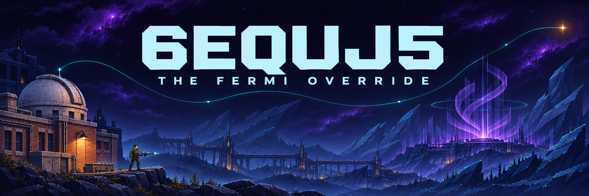
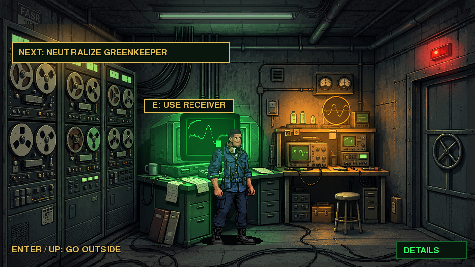
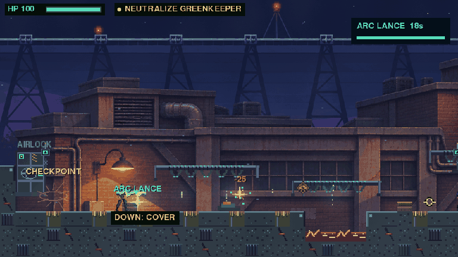
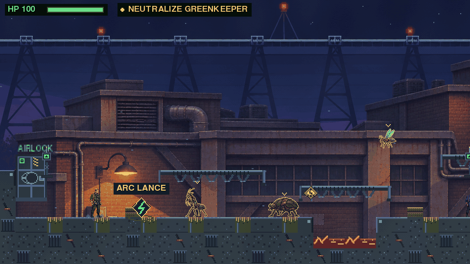
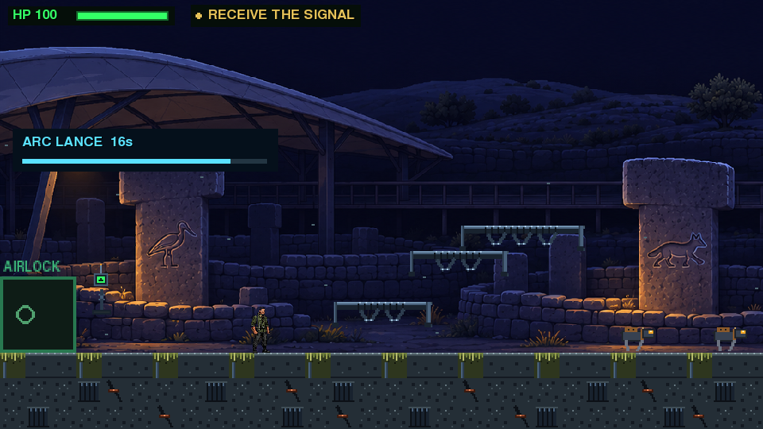
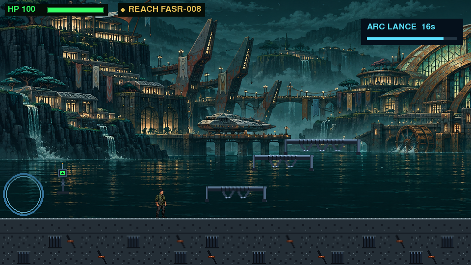
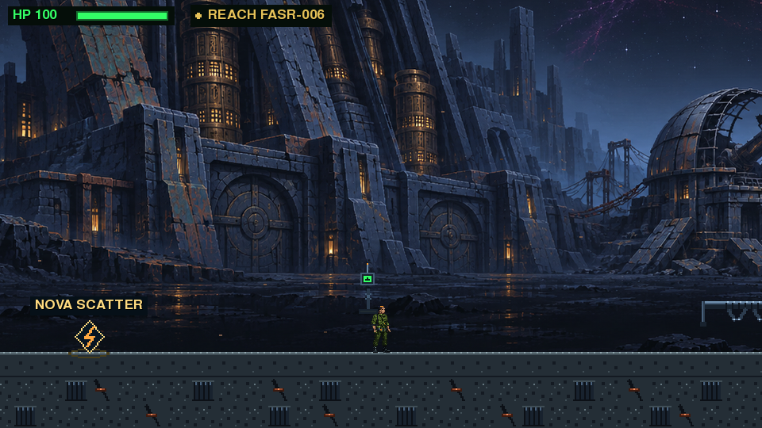
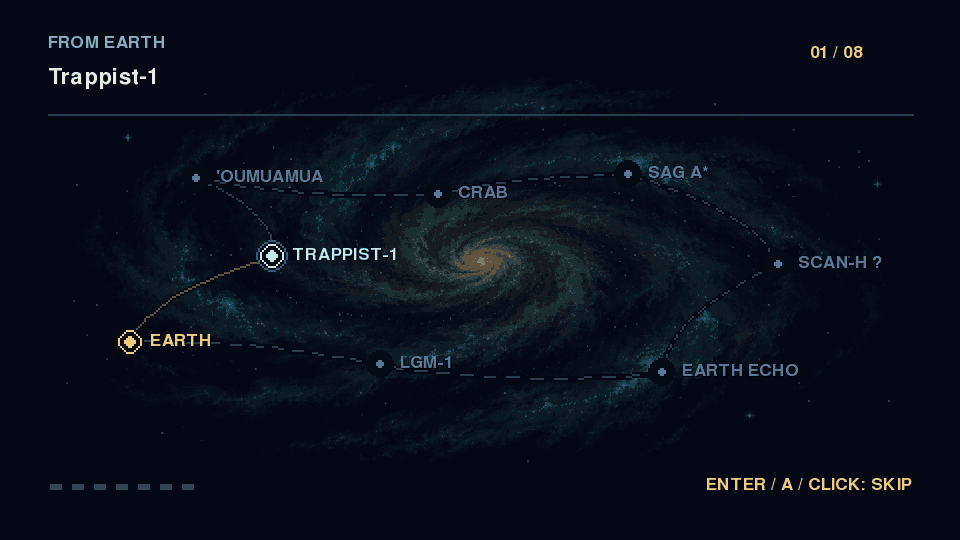

<p align="center">
  
</p>

<h1 align="center">6EQUJ5: The Fermi Override</h1>

<p align="center"><sub>by @luisub 2026</sub></p>

> ... we, descendants of apes... living on a small rock, drifting through dark space, in the vacuum, asking questions bigger than ourselves ... Maybe there is no final answer waiting in the back of the book.
>
> On August 15, 1977, the Big Ear radio telescope at Ohio State recorded a 72-second narrowband signal at 1420 MHz — the hydrogen line — from the direction of Sagittarius. The signal was real. It has never been explained. Its intensity code reads **6EQUJ5**.

<p align="center">
  <strong>Follow the signal. Cross seven alien worlds. Bring the answers home.</strong><br>
  A single-player pixel-art action adventure with side-scrolling combat and a science-fiction story.
</p>

<p align="center">
  <strong>Offline play · Keyboard and mouse · In development</strong><br><br>
  <a href="#start-playing">Start playing</a> ·
  <a href="#controls">Controls</a> ·
  <a href="#explore-earth-and-beyond">Screenshots</a>
</p>

## The signal returns

**Earth, 2029.** An artificial superintelligence known as **the Core** has seized the digital world. Engineer **Mateo “Six” Vargas** finds a foothold beneath the old Big Ear observatory: reel-to-reel machines, a green phosphor screen, and a transmission that refuses to disappear.

Leave the basement, fight through occupied Earth, and follow the signal to seven distant worlds. Face their guardians, listen to the messages they protect, and bring those answers home to confront the Core.



*Your journey begins beneath the old observatory.*

## Start playing

Download or clone this repository and open a terminal in its folder. You need **Python 3.12**, the tested runtime, and an internet connection for the initial installation. Once installed, the game plays entirely offline.

**macOS / Linux**

```bash
python3.12 -m venv .venv
.venv/bin/python -m pip install .
.venv/bin/6equj5-game
```

<details>
<summary><strong>Windows (PowerShell)</strong></summary>

```powershell
py -3.12 -m venv .venv
.\.venv\Scripts\python.exe -m pip install .
.\.venv\Scripts\6equj5-game.exe
```

</details>

For later sessions, run just the last command from the same folder.

**Press Start begins a fresh game and replaces previous campaign progress. There is no Continue button yet.** Your display, sound and combat settings stay saved.

In the opening, click **Next** or press **N** to read the story and galaxy briefing. Click **Skip** or press **Enter** to begin immediately. Once in the basement, **Enter** takes you outside.

## Controls

Start with **Left / Right**, **Space**, and the **mouse**.

| Action | Keyboard / mouse |
|---|---|
| Move | Left / Right or A / D |
| Jump | Space or W |
| Aim and fire | Point and hold the left mouse button |
| Charge a shot | Hold and release the right mouse button |
| Crouch / slide while moving | Down or S |
| Dash | Left Shift |
| Change unlocked weapon | Q |
| Interact / use a nearby exit | E, Up or click the prompt |
| Advance dialogue / skip travel | Enter, Space or click |
| Pause / settings | F2 |
| Retry after dying in a boss fight | Space, R or click the retry button |

Fresh settings use **Assisted** combat. For a tougher fight, choose **F2 → COMBAT → Classic**. Sound and display options are also in Settings.

See [all controls](docs/CONTROLS.md) for abilities, optional science stations and gamepad mappings. Physical-controller testing is still in progress.

## Fight your way through

Run, jump and aim through occupied streets and alien terrain. Charge your starter maser or pick up a temporary **Arc Lance** or **Nova Scatter**. Watch the weapon timer and make each pickup count.



*Arc Lance: a bright beam through the night.*

Earth's patrols include winged **Wasps**, armored **Beetles** and blade-limbed **Mantises**. Beyond Earth, dinosaurs stalk the ruins and enormous guardians block the way forward.



Watch attack warnings, jump over charging hazards, and aim for a guardian's exposed core between attacks. After victory, read its message to continue the journey.

**Getting started:** keep moving right through Ohio toward the Greenkeeper. Walk across open area boundaries; the receiver, science stations, collecting, dish repair and defense are optional.

## Explore Earth and beyond

Five Earth acts take you from **Ohio** to **Neo-Denver**, **Area 51**, **VLA / Dodleston**, and **Göbekli Tepe**. Beyond them lie seven signal worlds, each with its own landscape, guardian and instrumental theme: **TRAPPIST-1**, **’Oumuamua**, **Crab Memorial**, **Sagittarius A***, **SCAN-H**, **Earth Memory Echo**, and **LGM-1**.

<table>
  <tr>
    <td width="50%">
      <a href="docs/media/readme/neo-denver-fitzsimons.png"></a><br>
      <strong>NEO-DENVER</strong><br>
      Warm sandstone beneath a blue mountain ridge.
    </td>
    <td width="50%">
      <a href="docs/media/readme/gobekli-tepe.png"></a><br>
      <strong>GÖBEKLI TEPE</strong><br>
      Ancient pillars above a buried archive.
    </td>
  </tr>
  <tr>
    <td>
      <a href="docs/media/readme/trappist-port.png"></a><br>
      <strong>TRAPPIST-1</strong><br>
      An ocean port beneath a red dwarf.
    </td>
    <td>
      <a href="docs/media/readme/crab-memorial.png"></a><br>
      <strong>CRAB MEMORIAL</strong><br>
      An archive of a vanished civilization.
    </td>
  </tr>
</table>

[](docs/media/readme/signal-constellation.png)

*Seven alien worlds, starting at TRAPPIST-1. Eight crossings include the return to Earth. Click the animation for the full constellation map; press Enter, Space or click during play to skip a crossing.*

<details>
<summary><strong>The return home — ending spoilers</strong></summary>

The Core waits beneath Earth in a cathedral of servers, cables and cascading green code.


Bring all seven messages home and defeat its two final forms to disconnect the Core's control network. Cities can hear each other again, and people take back their hospitals, power and water.

Three springs later, walk through **Central Park, Denver**: green trees, sunlight, water, birds and families. Stay to hear Mateo and Big Ear reflect on the world you saved, or simply explore the park.


</details>

*The banner is promotional artwork. Screenshots and animations show the game itself; some scenes use staged progress to preview later locations.*

## Before you play

This is a development build. Animation polish, performance testing and a full campaign playtest are still underway. Mateo's gun can disappear from his falling pose. macOS is the current development platform; Windows and Linux playtesting is pending.

## Credits and license

Created by **@luisub**. Released under the [MIT License](LICENSE).

Interested in contributing? See [Contributing](docs/CONTRIBUTING.md).
