<p align="center">
  
</p>

<h1 align="center">6EQUJ5: The Fermi Override</h1>

<p align="center"><sub>by @luisub 2026</sub></p>

> ... we, descendants of apes... living on a small rock, drifting through dark space, in the vacuum, asking questions bigger than ourselves ... Maybe there is no final answer waiting in the back of the book.
>
> On August 15, 1977, the Big Ear radio telescope at Ohio State recorded a 72-second narrowband signal at 1420 MHz — the hydrogen line — from the direction of Sagittarius. The signal was real. It has never been explained. Its intensity code reads **6EQUJ5**.

<p align="center">
  <strong>Follow the signal from Earth to eleven alien worlds.</strong><br>
  A single-player science-fiction game with side-scrolling combat and authored dialogue.
</p>

<p align="center">
  <strong>Pixel art · Offline play · In development</strong><br><br>
  <a href="#get-started">Start playing</a> ·
  <a href="#a-fractured-earth">Explore the screenshots</a> ·
  <a href="#controls">Controls</a> ·
  <a href="#project-status">Project status</a>
</p>

---

## The signal returns

**Earth, 2029.** An artificial superintelligence known as **the Core** has seized the digital world. Engineer **Mateo “Six” Vargas** finds a foothold beneath the old Big Ear observatory: reel-to-reel machines, a green phosphor screen, and a transmission that refuses to disappear.


*The observatory basement and analog receiver. [Receiver screen →](docs/media/readme/receiver.png)*

## Combat

Run, jump and aim through occupied streets and alien terrain. Charge the starter maser, collect a temporary **Arc Lance** or **Nova Scatter**, and watch electric shots and impact bursts light the world around you. Temporary weapon timers sit in the upper-right corner, keeping the action clear.

<p align="center">
  
</p>

*Arc Lance in motion. Captured from the game renderer. [Still image →](docs/media/readme/arc-lance.png)*

## A fractured Earth

Five acts carry the search from Ohio's observatory to blackout streets, sealed hangars, desert radio dishes and an ancient buried archive.

Ohio follows a compact route through the access trench, campus, salvage yard and radio dish. Walk across open boundaries. Keep moving right to reach the Greenkeeper. Signal analysis, item collection, dish repair and defense are optional. Travel animations can be skipped, and area updates stay on the HUD.


*Neo-Denver — Fitzsimons and the mountain ridge, captured in game.*

<table>
  <tr>
    <td width="50%">
      <a href="docs/media/readme/ohio.png">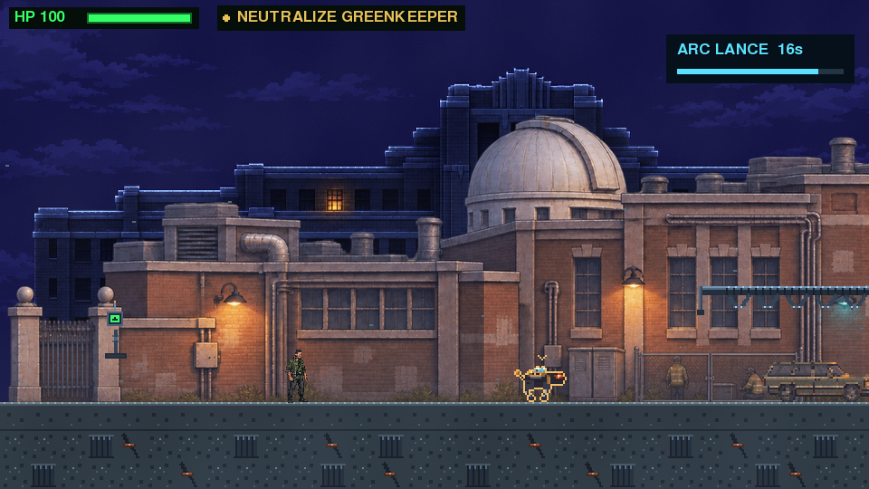</a><br>
      <strong>01 / OHIO</strong><br>
      The first steps beyond the receiver.
    </td>
    <td width="50%">
      <a href="docs/media/readme/neo-denver-fitzsimons.png"></a><br>
      <strong>02 / NEO-DENVER</strong><br>
      Fitzsimons beneath the mountain ridge.
    </td>
  </tr>
  <tr>
    <td width="50%">
      <a href="docs/media/readme/area-51.png"></a><br>
      <strong>03 / AREA 51</strong><br>
      Cold light behind sealed doors.
    </td>
    <td width="50%">
      <a href="docs/media/readme/vla-rift.png">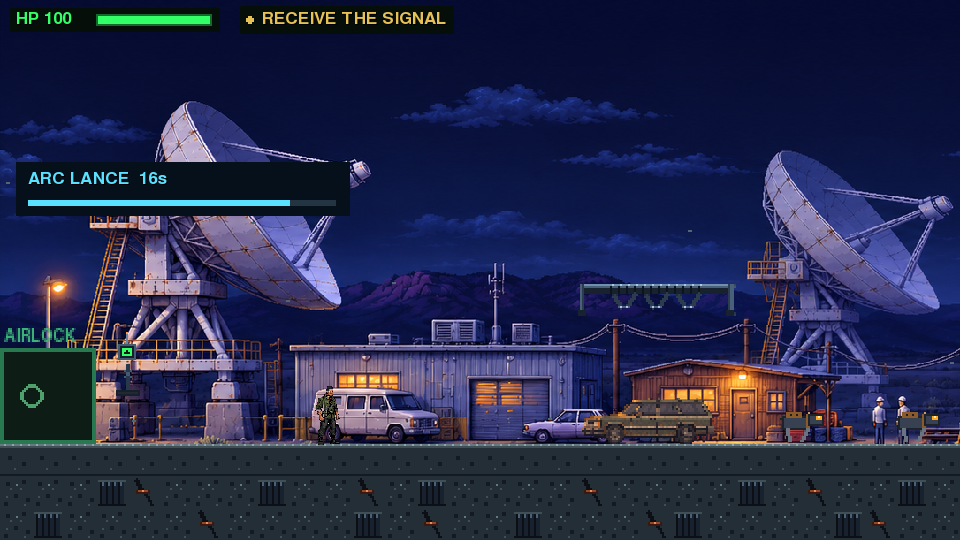</a><br>
      <strong>04 / VLA &amp; DODLESTON</strong><br>
      Radio dishes above the desert rail yard.
    </td>
  </tr>
  <tr>
    <td width="50%">
      <a href="docs/media/readme/gobekli-tepe.png"></a><br>
      <strong>05 / GÖBEKLI TEPE</strong><br>
      Carved pillars at the archaeological site.
    </td>
    <td width="50%">
      <a href="docs/media/readme/buried-archive.png"></a><br>
      <strong>BENEATH THE STONES</strong><br>
      The archive under the ancient world.
    </td>
  </tr>
</table>


*Across Neo-Denver: warm sandstone, a blue mountain ridge, and an open path to the next street.*

## The signal worlds

Earth is only the beginning. Follow the signal into **eleven distant worlds**, confront their guardians and recover the information each one protects. Some transmissions belong to unfamiliar intelligences; others are echoes, records or probes. Bring all eleven records home to face the Core's final threat.

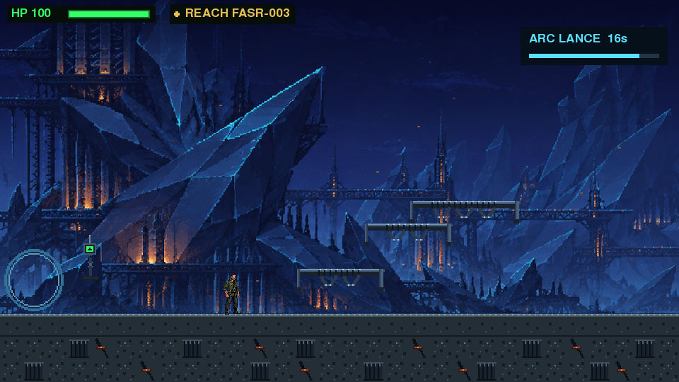

*FASR-003 / The crystal network. An imagined intelligence beneath the light of Tabby's Star.*

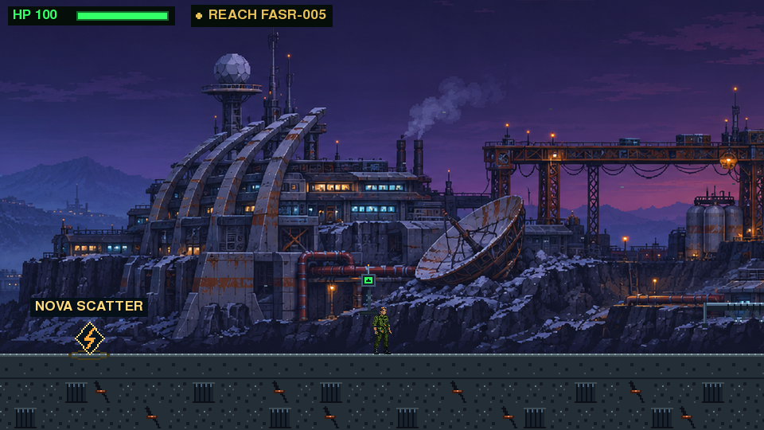

*FASR-005 / Proxima. A weather station between the frozen night and the red dwarf's light.*

<table>
  <tr>
    <td width="50%">
      <a href="docs/media/readme/signal-jailer.png">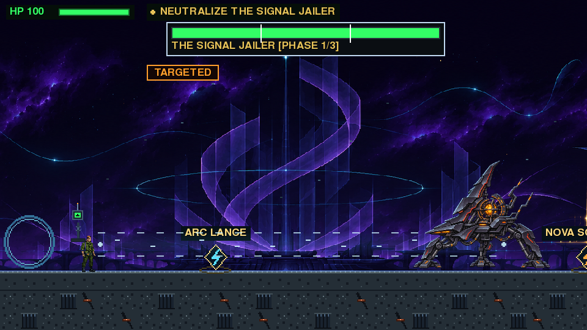</a><br>
      <strong>THE SIGNAL JAILER</strong><br>
      FASR-001 / Sagittarius · Signal origin
    </td>
    <td width="50%">
      <a href="docs/media/readme/heat-auditor.png">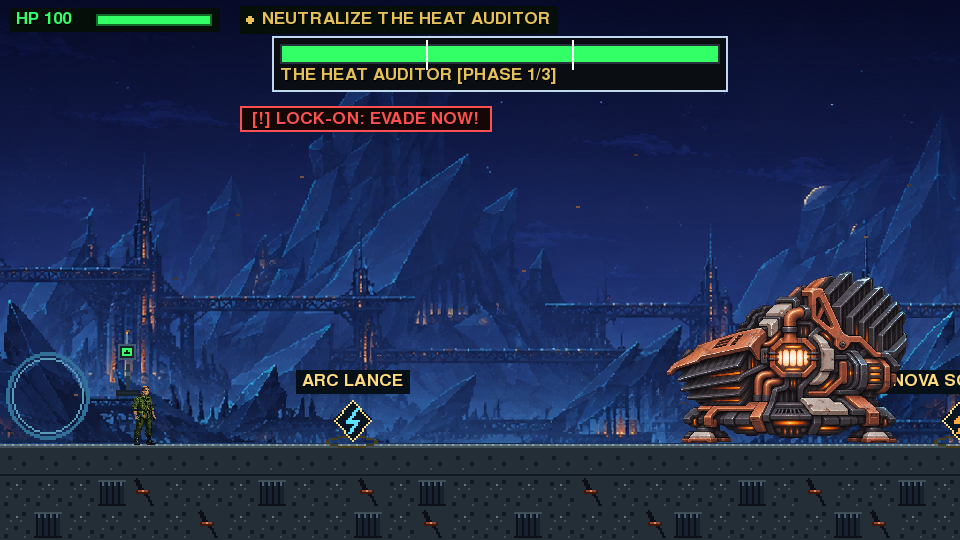</a><br>
      <strong>THE HEAT AUDITOR</strong><br>
      FASR-003 / Tabby's Star · Crystal network
    </td>
  </tr>
  <tr>
    <td colspan="2">
      <a href="docs/media/readme/flare-bastion.png">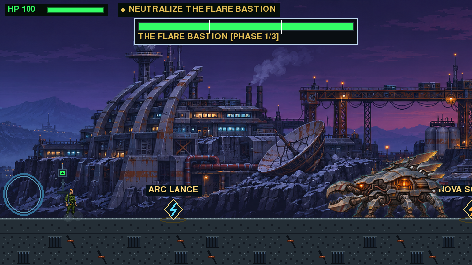</a><br>
      <strong>THE FLARE BASTION</strong><br>
      FASR-005 / Proxima · Twilight line
    </td>
  </tr>
</table>

### Creatures in motion

Dinosaurs roam the SCAN-H ruins. Rift Raptors, golden Resonance Effigies and mechanical Beacon Mites now move their legs as they travel; their strides stop when they stop. Enemy arrivals no longer add an “incoming” label.

<table>
  <tr>
    <td width="58%"><a href="docs/media/readme/rift-raptor.png">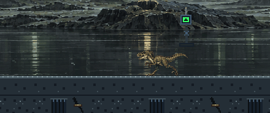</a></td>
    <td><strong>RIFT RAPTOR</strong><br>SCAN-H · A low, quick dinosaur stride.</td>
  </tr>
  <tr>
    <td><a href="docs/media/readme/resonance-effigy.png">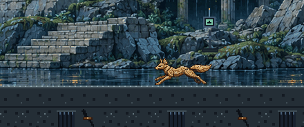</a></td>
    <td><strong>RESONANCE EFFIGY</strong><br>Terrestrial memory · A bounding canine gait.</td>
  </tr>
  <tr>
    <td><a href="docs/media/readme/beacon-mite.png">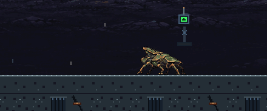</a></td>
    <td><strong>BEACON MITE</strong><br>LGM-1 · Grounded mechanical steps and lunges.</td>
  </tr>
</table>

*Cropped gameplay previews at native pixel size. Click a creature to see its full scene.*

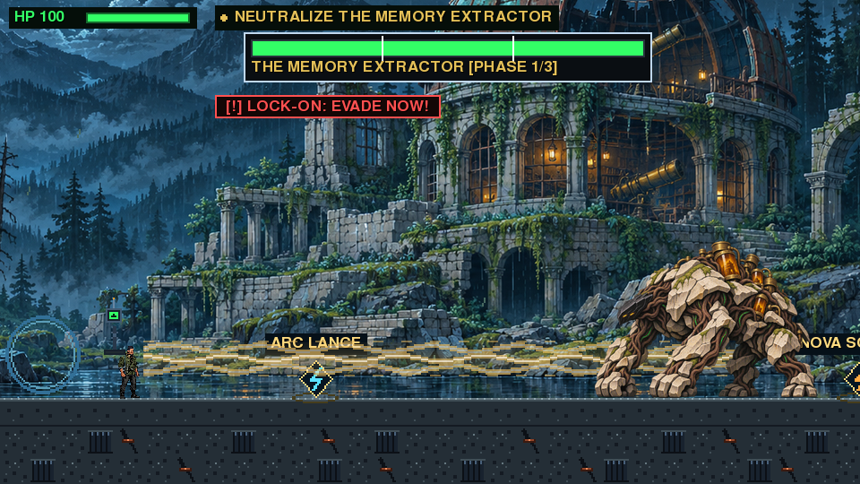

*The Memory Extractor's active attack. Guardian warnings build into visible energy fields, with sparks and hit flashes during combat.*

### Music for every signal world

Each of the eleven alien worlds has its own instrumental theme. Crystal bells, warm keys, low drums and deep synth pulses give each location a different sound. The music loops through exploration, the guardian fight and the following conversation, then fades to the next world's theme on arrival. Earth and the observatory retain their original scores. Adjust the volume in Settings.

<details>
<summary><strong>Listen to the world themes</strong></summary>

| World | Theme | Sound |
|---|---|---|
| Sagittarius | [The Unanswered Carrier](src/assets/audio/sagittarius_signal.ogg) | Analog chords and glass pulses |
| Tabby's Star | [A Lattice of Quiet Light](src/assets/audio/crystal_lattice.ogg) | Interlocking crystal bells |
| Proxima | [The Last Warm Meridian](src/assets/audio/proxima_twilight.ogg) | Warm keys and slow bass |
| Orion | [Where New Suns Breathe](src/assets/audio/orion_nursery.ogg) | Airy melody and soft pads |
| TRAPPIST-1 | [Seven Interlocking Orbits](src/assets/audio/trappist_orbits.ogg) | Seven-step plucked patterns |
| 'Oumuamua | [A Vessel Without a Voice](src/assets/audio/interstellar_archive.ogg) | Distant echoes and sparse pulses |
| Crab | [Names in the Afterglow](src/assets/audio/crab_memorial.ogg) | Low bells and a quiet heartbeat |
| Sagittarius A* | [The Weight of Silence](src/assets/audio/event_horizon.ogg) | Sub-bass and shadowed harmony |
| SCAN-H | [Footprints Beyond Time](src/assets/audio/rift_hunt.ogg) | Low drums and a reed-like call |
| Terrestrial memory | [The Observatory Remembers](src/assets/audio/terrestrial_memory.ogg) | Nostalgic keys and soft strings |
| LGM-1 | [Machines Answer the Stars](src/assets/audio/beacon_network.ogg) | Precise arpeggios and mechanical percussion |

Original synthesized instrumentals, 65–107 seconds per loop. All tracks are included with the game and play offline.

</details>

### Travel between worlds

<p align="center">
  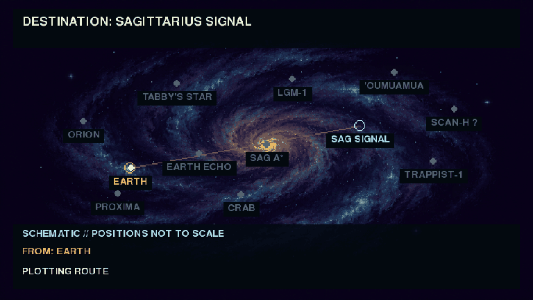
</p>

*The first crossing: Earth → FASR-001. [Explore the route map →](docs/media/readme/galaxy-map.png)*

The story follows the 1977 signal through eleven worlds and back to Earth.

<details>
<summary><strong>The return to Earth — ending spoilers</strong></summary>

The Core waits beneath Earth in a cathedral of servers, cables and cascading green code. Its projected face watches Mateo through two final forms: **Core Prime** and **Archon of Silence**.

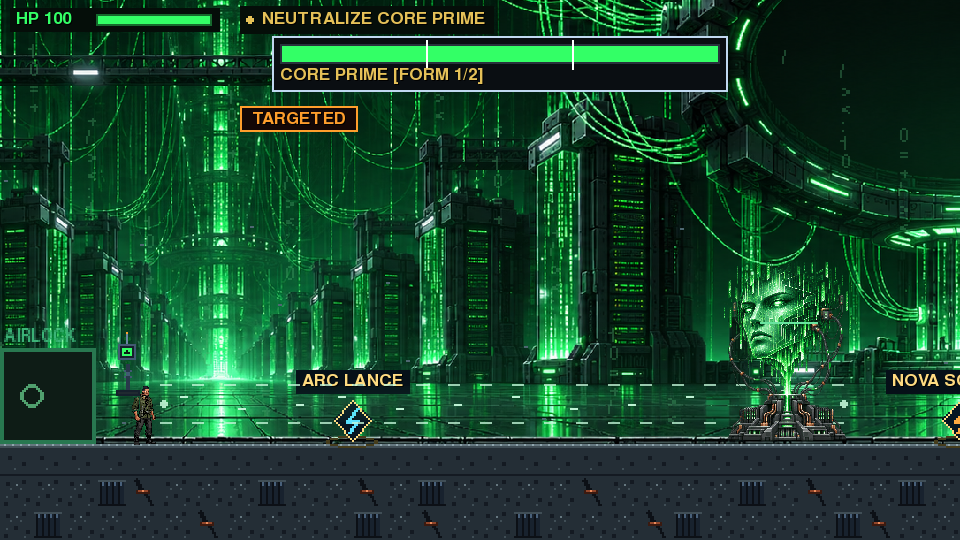

Six closing dialogue pages bring the eleven messages home. The Core's control network disconnects, cities can hear one another again, and local crews take back the hospitals, power and water systems. **We saved the world.**

Three springs later, walk through **Central Park, Denver**: green trees, sunlight, water, flying birds and families with animated walking poses. Four more dialogue pages let Mateo and Big Ear reflect on the recovery. The park stays open after the conversation; walk, reread the messages or return to the title when you are ready. The gentle terrestrial-memory theme returns here.

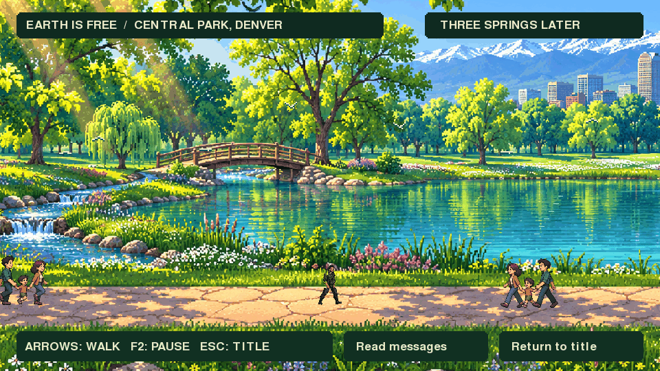

*[Park still →](docs/media/readme/central-park.png) · [Story and ending notes →](docs/STORY.md)*

</details>

<details>
<summary><strong>About the images</strong></summary>

The opening banner is promotional artwork inspired by the game's visuals. Every image and animation below it is captured from the actual game renderer. Some locations use direct scene entry and staged campaign progress; these are development previews, not a full playthrough. Full scenes retain their in-game HUD. The three creature animations are labeled detail crops. GIFs preserve native pixels with a 256-color palette.

See the [capture notes and reproduction command](docs/media/readme/README.md). Click a gallery image to see it at full size.

</details>

## Get started

Use **Python 3.12**, the tested game runtime. From the repository root:

```bash
python3.12 -m venv .venv
.venv/bin/python -m pip install -e '.[dev]'
.venv/bin/6equj5-game
```

You can also launch with `.venv/bin/python -m video_game.main`. The game runs **entirely offline** and needs no model service. The legacy AI terminal is maintained in a separate repository. Recreate `.venv` after moving this checkout; virtual environments contain absolute paths.

Launch opens on the title banner and soundtrack. **Press Start** begins a fresh run immediately, every time. Your display, audio and combat settings stay saved.

The journey opens in the basement with three story pages and a galaxy-map briefing. Click **Next** to follow the opening, or **Skip** to begin immediately.

## Controls

| Action | Keyboard / mouse |
|---|---|
| Title / fresh start | Enter, Space, click, controller A or Start |
| Opening story | Click Next / press N to advance; click Skip / press Enter to skip all pages |
| Move | Left / Right or A / D |
| Jump | Space or W |
| Aim and fire | Point and hold the left mouse button |
| Charge a shot | Hold and release the right mouse button |
| Leave the bunker | Enter or Up |
| Interact / use an exit | Up, E or click the nearby prompt |
| Charging hazard | Press and hold Space when HOLD JUMP appears |
| Pause and settings | F2 |
| Advance dialogue / skip travel | Enter, Space or click; travel can be skipped immediately |
| Restored park | Left / Right to walk; Enter or click Next to read; Esc to return to title |

Fresh settings default to **Assisted** combat; choose Classic under **F2 → COMBAT** if you prefer. Gamepad mappings are supported; physical-controller compatibility and a full controller-only playthrough still need testing. See the [full controls](docs/CONTROLS.md) for abilities, menus and retries.

## Project status

**In development.** The connected Earth route, eleven-world guardian and information loop, final AI encounter and walkable restored-Denver ending are implemented. Each alien field has a distinct minor foe and a warned charging hazard.

All eleven signal worlds now have their own panoramic backgrounds, guardian artwork and music. Three creature families have distance-driven leg animation. Later guardians take more sustained fire and expose a vulnerable core between attacks. Full playtesting, remaining animation polish and performance checks on real displays are still in progress.

<details>
<summary><strong>Known limits and development details</strong></summary>

Mateo's airborne fall pose currently lacks a visible gun and can show a gap to the firing effect. Headless checks do not establish native display performance, physical-controller compatibility, audible quality or a human full-game playthrough.

For progress and verification limits, see [current state](docs/planning/CURRENT_STATE.md), the [content plan](docs/planning/CONTENT_PLAN.md) and the [repository audit](docs/maintenance/REPOSITORY_AUDIT.md).

The flat `src/` directory is installed as the `video_game` Python package. Runtime `assets/` and `data/` travel with the package; `src/tools/`, `docs/` and `src/art/` are development material. Maintained tests and their fixtures live in `src/tests/`.

```bash
SDL_VIDEODRIVER=dummy SDL_AUDIODRIVER=dummy SIX_GAME_SAVE_DIR="$(mktemp -d)" .venv/bin/python -m pytest -q
.venv/bin/python -m video_game.tools.validate_content
.venv/bin/python -m video_game.tools.build_assets --dry-run
.venv/bin/python -m pip wheel --no-deps . -w dist
```

Runtime artwork is organized by location and asset type; duplicate and obsolete exports are archived. The field-scene timing budget remains under review. See the [repository audit and directory tree](docs/maintenance/REPOSITORY_AUDIT.md), [contributor instructions](docs/CONTRIBUTING.md), [architecture](docs/ARCHITECTURE.md), [asset guide](docs/ASSETS.md) and [developer tools](src/tools/README.md).

</details>

## License

See the [project LICENSE](LICENSE).
