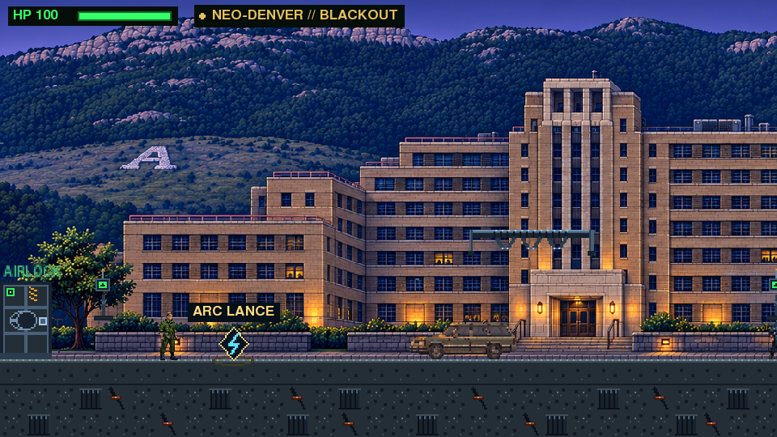
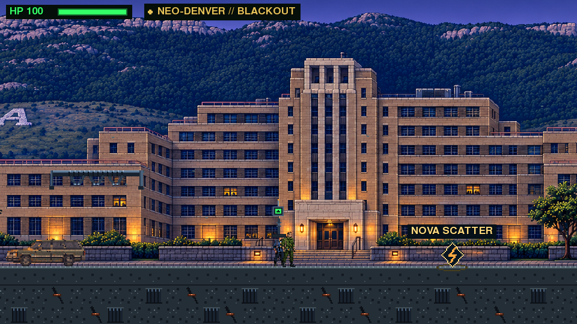
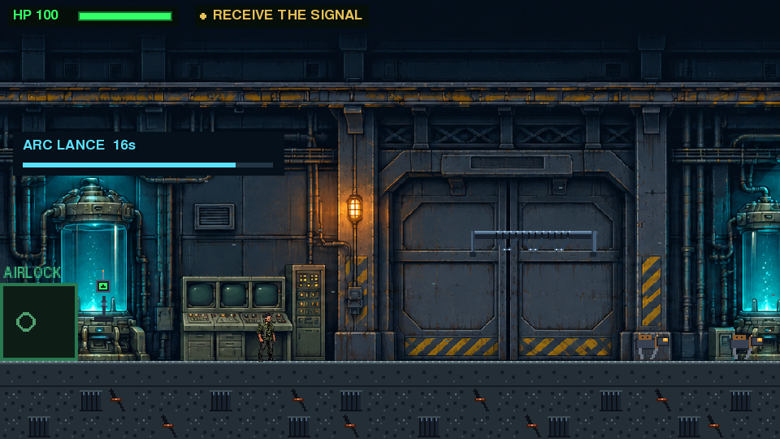
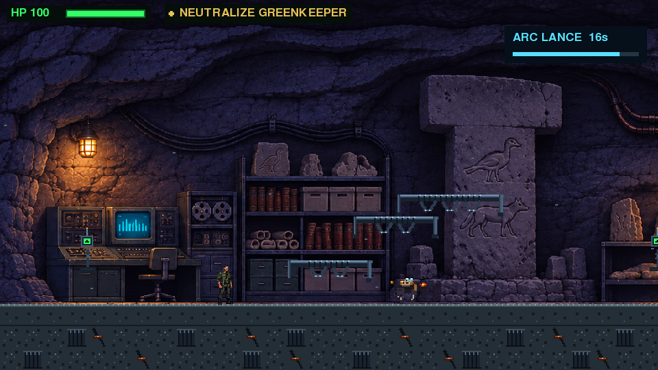
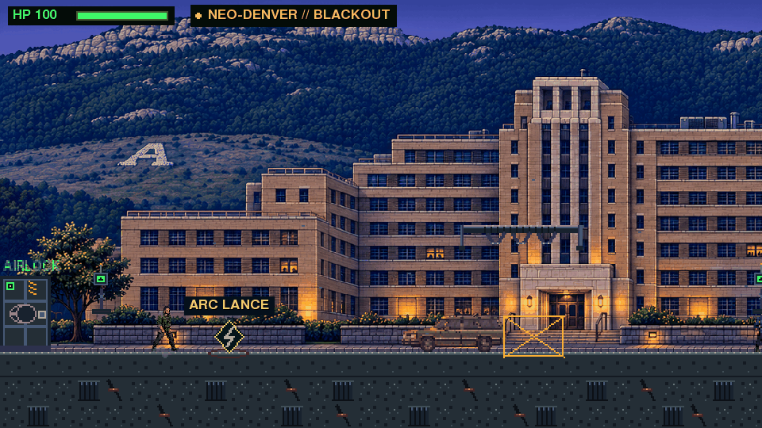

<p align="center">
  
</p>

<h1 align="center">6EQUJ5: The Fermi Override</h1>

> ... we, descendants of apes... living on a small rock, drifting through dark space, in the vacuum, asking questions bigger than ourselves ... Maybe there is no final answer waiting in the back of the book.
>
> On August 15, 1977, the Big Ear radio telescope at Ohio State recorded a 72-second narrowband signal at 1420 MHz — the hydrogen line — from the direction of Sagittarius. The signal was real. It has never been explained. Its intensity code reads **6EQUJ5**.

<p align="center">
  <strong>Follow the signal from Earth to eleven alien worlds.</strong><br>
  A single-player science-fiction game with side-scrolling combat and authored dialogue.
</p>

<p align="center">
  <strong>Pixel art · Offline play · In development</strong><br><br>
  <a href="#get-started">Start playing</a> ·
  <a href="#a-fractured-earth">Explore the screenshots</a> ·
  <a href="#controls">Controls</a> ·
  <a href="#project-status">Project status</a>
</p>

---

## The signal returns

**Earth, 2029.** An artificial superintelligence known as **the Core** has seized the digital world. Engineer **Mateo “Six” Vargas** finds a foothold beneath the old Big Ear observatory: reel-to-reel machines, a green phosphor screen, and a transmission that refuses to disappear.


*The observatory basement and analog receiver. [Receiver screen →](docs/media/readme/receiver.png)*

## Combat

Run, jump and aim through occupied streets and alien terrain. Charge the starter maser, collect a temporary **Arc Lance** or **Nova Scatter**, and watch electric shots and impact bursts light the world around you.

<p align="center">
  
</p>

*Arc Lance in motion. Captured from the game renderer. [Still image →](docs/media/readme/arc-lance.png)*

## A fractured Earth

Five acts carry the search from Ohio's observatory to blackout streets, sealed hangars, desert radio dishes and an ancient buried archive.

Ohio follows a compact route through the access trench, campus, salvage yard and radio dish. Walk across open boundaries. Repairing the feedhorn opens the Greenkeeper's gate immediately; staying to defend the dish is optional. Travel animations can be skipped, and area updates stay on the HUD.



*Neo-Denver — Fitzsimons and the mountain ridge, captured in game.*

<table>
  <tr>
    <td width="50%">
      <a href="docs/media/readme/ohio.png"></a><br>
      <strong>01 / OHIO</strong><br>
      The first steps beyond the receiver.
    </td>
    <td width="50%">
      <a href="docs/media/readme/neo-denver-fitzsimons.png"></a><br>
      <strong>02 / NEO-DENVER</strong><br>
      Fitzsimons beneath the mountain ridge.
    </td>
  </tr>
  <tr>
    <td width="50%">
      <a href="docs/media/readme/area-51.png"></a><br>
      <strong>03 / AREA 51</strong><br>
      Cold light behind sealed doors.
    </td>
    <td width="50%">
      <a href="docs/media/readme/vla-rift.png"></a><br>
      <strong>04 / VLA &amp; DODLESTON</strong><br>
      Radio dishes above the desert rail yard.
    </td>
  </tr>
  <tr>
    <td width="50%">
      <a href="docs/media/readme/gobekli-tepe.png"></a><br>
      <strong>05 / GÖBEKLI TEPE</strong><br>
      Carved pillars at the archaeological site.
    </td>
    <td width="50%">
      <a href="docs/media/readme/buried-archive.png"></a><br>
      <strong>BENEATH THE STONES</strong><br>
      The archive under the ancient world.
    </td>
  </tr>
</table>



*Across Neo-Denver: warm sandstone, a blue mountain ridge, and an open path to the next street.*

## The signal worlds

Earth is only the beginning. Follow the signal into **eleven distant worlds**, confront their guardians and recover the information each one protects. Some transmissions belong to unfamiliar intelligences; others are echoes, records or probes. Bring all eleven records home to face the Core's final threat.


*FASR-003 / The crystal network. An imagined intelligence beneath the light of Tabby's Star.*

<table>
  <tr>
    <td width="50%">
      <a href="docs/media/readme/signal-jailer.png"></a><br>
      <strong>THE SIGNAL JAILER</strong><br>
      FASR-001 / Sagittarius · Signal origin
    </td>
    <td width="50%">
      <a href="docs/media/readme/heat-auditor.png"></a><br>
      <strong>THE HEAT AUDITOR</strong><br>
      FASR-003 / Tabby's Star · Crystal network
    </td>
  </tr>
</table>

### Travel between worlds

<p align="center">
  
</p>

*The first crossing: Earth → FASR-001. [Explore the route map →](docs/media/readme/galaxy-map.png)*

The story is fiction inspired by astronomical locations and signals. The travel map is schematic; its positions are fictional and not to scale.

<details>
<summary><strong>About the images</strong></summary>

The opening banner is promotional artwork inspired by the game's visuals. Every image and animation below it is captured from the actual game renderer. Some locations use direct scene entry and staged campaign progress; these are development previews, not a full playthrough. Screenshots retain their in-game HUD. The two featured alien realms and guardians are the current art benchmarks.

See the [capture notes and reproduction command](docs/media/readme/README.md). Click a gallery image to see it at full size.

</details>

## Get started

Use **Python 3.12**, the tested game runtime. From the repository root:

```bash
python3.12 -m venv .venv
.venv/bin/python -m pip install -e '.[dev]'
.venv/bin/6equj5-game
```

You can also launch with `.venv/bin/python -m video_game.main`. The game runs **entirely offline** and needs no model service. The legacy AI terminal is maintained in a separate repository. Recreate `.venv` after moving this checkout; virtual environments contain absolute paths.

A new game opens in the basement with three story pages and a galaxy-map briefing. Click **Next** to follow the opening, or **Skip** to begin immediately. Checkpoints and earned discoveries persist. Continue starts in the bunker and resumes the saved route or interrupted conversation; a pending world journey resumes its transition.

## Controls

| Action | Keyboard / mouse |
|---|---|
| Opening story | Click Next / press N to advance; click Skip / press Enter to skip all pages |
| Move | Left / Right or A / D |
| Jump | Space or W |
| Aim and fire | Point and hold the left mouse button |
| Charge a shot | Hold and release the right mouse button |
| Leave the bunker | Enter or Up |
| Interact / use an exit | Up, E or click the nearby prompt |
| Charging hazard | After INCOMING, press and hold Space when HOLD JUMP appears |
| Pause and settings | F2 |
| Advance dialogue / skip travel | Enter, Space or click; travel can be skipped immediately |

Fresh settings default to **Assisted** combat; choose Classic under **F2 → COMBAT** if you prefer. Gamepad mappings are supported; physical-controller compatibility and a full controller-only playthrough still need testing. See the [full controls](docs/CONTROLS.md) for abilities, menus and retries.

## Project status

**In development.** The connected Earth route, eleven-world guardian and information loop, return to Earth and final AI encounter are implemented. Each alien field has a distinct minor foe and a warned charging hazard.

FASR-001 and FASR-003 have the realm backdrops and guardians shown above. The other nine alien realms currently use temporary existing-art fallbacks for their backgrounds and guardians. Full playtesting, animation polish and performance checks on real displays are still in progress.

<details>
<summary><strong>Known limits and development details</strong></summary>

Mateo's airborne fall pose currently lacks a visible gun and can show a gap to the firing effect. Headless checks do not establish native display performance, physical-controller compatibility, audible quality or a human full-game playthrough.

For progress and verification limits, see [current state](docs/planning/CURRENT_STATE.md), the [content plan](docs/planning/CONTENT_PLAN.md) and the [separation report](docs/migration/REPORT.md).

The flat `src/` directory is installed as the `video_game` Python package. Runtime `assets/` and `data/` travel with the package; `tools/`, `docs/` and `art/` are development material. The test suite is kept locally and excluded from Git; the pytest command below requires that local copy.

```bash
SDL_VIDEODRIVER=dummy SDL_AUDIODRIVER=dummy SIX_GAME_SAVE_DIR="$(mktemp -d)" .venv/bin/python -m pytest tests -q
.venv/bin/python -m tools.validate_content
.venv/bin/python -m tools.build_assets --dry-run
.venv/bin/python -m pip wheel --no-deps . -w dist
```

The known missing legacy portrait rebuild input and intermittent render-budget failure are documented in the separation report; tests retain their assertions. See [contributor instructions](CONTRIBUTING.md), [architecture](docs/ARCHITECTURE.md) and [developer tools](tools/README.md).

</details>

## License

See the [project LICENSE](LICENSE).
