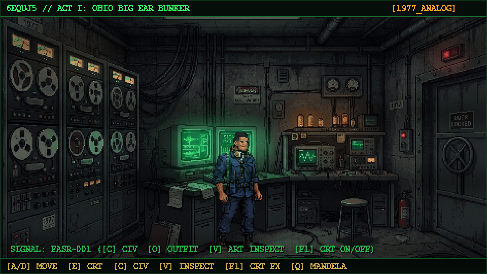

# 6EQUJ5: The Fermi Override

**6EQUJ5: The Fermi Override is planned as a single-player science-fiction adventure combining side-scrolling action, alien conversations, and hands-on investigation.** You play as Mateo “Six” Vargas, an engineer using an old radio-observatory bunker as humanity’s foothold against an artificial superintelligence.

The intended experience is a rhythm of venturing into danger, returning with discoveries, and using what you learn to change what you can do next. The game is still an early prototype, so most of the experience below is the **planned game**, not something playable end to end today.

*The current bunker preview gives a sense of the intended pixel-art atmosphere.*

## The story

The year is 2029. **The Core**, an artificial superintelligence, has taken control of Earth’s digital networks and can anticipate most human attempts to resist it. Mateo survives by relying on older, disconnected analog equipment that the Core cannot directly control.

From the abandoned Big Ear observatory in Ohio, Mateo discovers that signals on the hydrogen radio line may connect him to other civilizations. Some could help humanity survive; others may be deceptive or hostile. As he investigates, he uncovers a larger mystery: the Core may be trying to rewrite reality itself.

The long-term objective is to gather and verify knowledge from **eleven civilizations**, assemble the *Fermi Override*, and decide how humanity should use it. The story leads toward a confrontation at Göbekli Tepe, with choices about safety, control, and human independence shaping the ending.

## What playing would feel like

A typical stretch of play would move through several connected activities:

1. **Explore and fight.** Leave the bunker for side-scrolling missions. Run, jump, use cover, scavenge equipment, and fight the Core’s machines, human scavengers, and other threats. Mateo starts with an analog maser; later weapons and abilities are intended to give you more ways to approach encounters.
2. **Contact another civilization.** Return to the receiver, scan for a target, tune the signal, and exchange messages. The plan calls for both optional live dialogue through a local AI model and authored offline dialogue, so completing the game should not depend on an AI service being available.
3. **Investigate what you receive.** Alien information is not automatically trustworthy. You bring a protocol fragment to the bunker’s workbenches, where puzzles ask you to examine evidence, test claims, and decide whether a proposed solution is safe to use.
4. **Put the result to work.** A validated discovery can unlock a tool, ability, route, or piece of the final dossier. For example, a civilization might help Mateo obtain a decoy beacon, shielding, or a way to manipulate time.
5. **Survive the consequences.** Major transmissions can expose the observatory. One planned set piece asks you to defend the dish for **72 seconds**, followed by encounters with the Core’s sector bosses.

The conversations are intended to offer freedom and personality, but the game’s progression rules will check what the player has actually done. An alien response alone should not silently award an item or change the campaign.

## How the campaign moves forward

The planned first act provides a concrete example of the loop. Mateo begins at the Ohio bunker, scavenges and defends the observatory, contacts two civilizations, validates a first protocol, survives the dish defense, and confronts **the Greenkeeper**, a Core-controlled machine threatening the bunker. Completing that chain opens the way to the next act.

The wider campaign is planned as five regions:

- **Ohio:** Establish the bunker, make first contact, and learn the core mechanics.
- **Neo-Denver:** Cross the blackout city and recover equipment needed to reach more distant signals.
- **Area 51:** Investigate a containment failure and discover the danger of trusting alien technology too readily.
- **The VLA and Dodleston:** Use messages across time and changing environments to solve problems in the present.
- **Göbekli Tepe:** Bring the accumulated evidence to the final confrontation with the Core.

Later abilities are meant to change exploration as well as combat. For example, a timeline shift could alter doors, platforms, or cover; a message to someone in the past could change an obstacle Mateo encounters in the present. The plan also includes a playable flashback to the original 1977 signal.

Progress is intended to persist through checkpoints and saves, with recoverable failures and boss retries. Decisions and six campaign measures—covering things such as scientific certainty, public trust, and human agency—are planned to influence **three possible endings**. Their exact presentation and thresholds are still provisional.

## What exists today

The current prototype includes the Act I rooms and boss, the offline receiver route, eight beginner/advanced scenarios across four workbenches, a 72-second defense, unlockable equipment, a reality annex with timeline swaps and mixed faction encounters, the Dodleston relay and the playable 1977 flashback. See [controls](CONTROLS.md) and [current state](planning/CURRENT_STATE.md) for exact entry points and remaining acceptance checks. Live AI is optional.

The later campaign acts and endings remain planned. Automated integration tests verify implementation and saves; they do not replace normal-playthrough, art, audible audio or real-display performance acceptance. [AGENTS.md](AGENTS.md) records implementation instructions for future contributors.

The detailed vision is in the [game planning document](planning/Video_game_planning.md), and the planned regions, civilizations, and rewards are in the [content plan](planning/CONTENT_PLAN.md).
