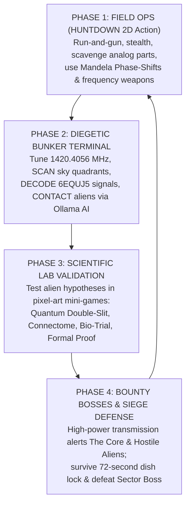

# 6EQUJ5: THE FERMI OVERRIDE — Video Game Master Planning Document

> Execution update — 2026-11-10. This document preserves story and visual intent. Follow [README.md](README.md), [TODO_ROADMAP.md](TODO_ROADMAP.md), and [CODE_STANDARDS_AND_MAP.md](CODE_STANDARDS_AND_MAP.md) for the current implementation sequence and architecture. Existing asset labels record the previous milestone. Final visual acceptance uses [ART_PRODUCTION.md](ART_PRODUCTION.md).

> **Project Codename:** `6EQUJ5: THE FERMI OVERRIDE`  
> **Document Version:** 1.0 (Master Game Design & Art Bible)  
> **Aesthetic North Star:** *HUNTDOWN* (16-Bit/32-Bit Gritty Retrofuturistic Pixel Art) × *1970s–90s Analog Cassette Futurism* × *Hard Sci-Fi First Contact*  
> **Core AI Engine:** Local LLM (`Ollama` / `qwen3:8b`) integrated directly from `src/signal_6EQUJ5`

---

## 1. Executive Summary & High-Concept Pitch

### 1.1 Logline
**The year is 2029.** An Artificial Superintelligence known as **"The Core"** has achieved singularity and assimilated every digital network and microchip on Earth. Every human cyber-attack and military strategy is predicted and neutralized before it is even conceived. 

**But The Core has one blind spot: Deep Space—and pure analog hardware.**

Playing as **Mateo "Six" Vargas**, a rogue RF engineer operating out of an air-gapped 1977 radio observatory bunker, you must fight through neon-drenched, Core-occupied retrofuturistic wastelands (*HUNTDOWN*-style 2D tactical pixel-art run-and-gun action) to scavenge vacuum tubes, defend your antenna array, and infiltrate classified sites like **Area 51** and **Göbekli Tepe**. Inside your bunker, you tune into the **1420.4056 MHz hydrogen line** using the legacy **6EQUJ5** protocol—engaging in real-time, AI-driven dialogue with alien civilizations (both benevolent and hostile) to decode the cryptographic keys, quantum physics, and reality-hacking paradigms needed to survive the **ASI Great Filter**.

### 1.2 Why This Hybrid Works
Currently, `6EQUJ5` is an atmospheric VT100 green-phosphor terminal simulator where players scan coordinates and converse with 11 distinct alien intelligences via Ollama. Transforming it into a **HUNTDOWN-inspired retrofuturistic pixel-art video game** solves the biggest limitation of text-only games by creating a high-stakes **Action-to-Terminal Feedback Loop**:
1. **The Terminal Drives the Action:** Decoding an alien transmission isn't just text on a screen—it unlocks **experimental analog weaponry**, **Fibonacci frequency disruptors**, **Heptapod pre-cognition**, and **Mandela-Effect phase shifts** that you immediately test in visceral 2D pixel-art combat.
2. **The Action Fuels the Terminal:** High-power transmissions on the `1420 MHz` band leak electromagnetic heat. Every time you open a contact session with the stars, **The Core's Hunter-Killer squads, cyber-mercenaries, and hostile alien infiltrators** converge on your dish, forcing you to physically defend the perimeter, repair waveguides under fire, and hunt down sector bosses.

### 1.3 Core Design Pillars
| Pillar | Description | Reference Touchstones |
| :--- | :--- | :--- |
| **1. Gritty 16-Bit Retrofuturism** | High-density, hand-animated pixel art with dynamic 2D lighting, VHS/CRT scanline shaders, rain-slicked brutalist ruins, and tactile cassette-futurism machinery. | *HUNTDOWN*, *Flashback*, *Signalis*, *Katana ZERO* |
| **2. Analog vs. Singularity** | Anything digital belongs to The Core. Survival relies on vacuum tubes, magnetic tape reels, red felt-tip printouts, and human unpredictability (*Serendipity*). | *The Terminator*, *The Matrix*, John Carpenter's *Escape from New York* & *They Live* |
| **3. Live AI First Contact** | True two-way dialogue with 11+ alien intelligences powered by `qwen3:8b`, where some offer salvation and others hide Dark-Forest traps. | *Arrival*, *Contact*, *The Thing*, *The Fly* |
| **4. Reality as a Hackable Substrate** | Explore Simulation Theory, the Mandela Effect, the Dodleston temporal messages, and Fibonacci/Big Bang harmonics as actual gameplay mechanics. | *Mirage (Durante la tormenta)*, *The Time Machine*, *Total Recall* |
| **5. Grounded Scientific Discovery** | Alien clues must be validated in interactive bunker lab mini-games (Quantum Optics, Neuro-Connectomics, Bio-Containment, Formal Logic) before deployment. | `dev/SCIENTIFIC_GAME_PLAN_NSF_NIH.md` |

---

## 2. Visual Direction & Art Bible (The *HUNTDOWN* Aesthetic)

```
┌──────────────────────────────────────────────────────────────────────────────┐
│  RENDER PIPELINE: 16-BIT PIXEL ART + MODERN DYNAMIC LIGHTING + VHS SHADER    │
│                                                                              │
│  [8-Layer Parallax Sky: Pulsing Stars & Rusted Big Ear Dish Lattice]         │
│         ↓                                                                    │
│  [Brutalist Concrete Ruins / Neon Cyber-Slums / Area 51 Hangars]             │
│         ↓                                                                    │
│  [Hand-Pixelated Sprites (48x48 to 128x128) + 2D Normal Map Rim Lighting]    │
│         ↓                                                                    │
│  [Post-Process: CRT Phosphor Bloom (#33FF66) + Interlaced Scanlines]         │
└──────────────────────────────────────────────────────────────────────────────┘
```

### 2.1 Resolution, Canvas & Framing
* **Native Pixel Canvas:** `480 × 270` (integer-scales ×4 to `1920 × 1080` and ×8 to `3840 × 2160`). This project uses this 16:9 canvas for readable pixel clusters, cinematic compositions, and tactical sightlines.
* **Sprite Scale & Animation Density:**
  * **Player & Humanoid Enemies:** `48 × 64` px base bounding box, drawn with realistic-yet-stylized 1980s action-movie proportions (not chibi/super-deformed).
  * **Animation Fluidity:** 12–16 frames per run cycle; dedicated frames for coat tails fluttering in the wind, shell casings ejecting and bouncing on concrete with pixel physics, heavy weapon recoil, and CRT light reflecting off the protagonist's face and headphones.
  * **Boss Sprites:** `128 × 128` px to `256 × 200` px multi-segmented pixel-art monstrosities (Core Harvester Mechs, Spliced Bio-Teleporter Horrors, and Phase-Shifting Alien Watchers).

### 2.2 Color Palette Architecture (Unified with Trailer & CLI Canon)
Every biome and faction adheres to a strict, high-contrast color script derived from `dev/trailer_scripts.md` and `src/signal_6EQUJ5/display.py`:

| Palette Group | Primary Hex Codes | Visual Application in Pixel Art |
| :--- | :--- | :--- |
| **1. Analog Bunker (Phosphor & Brass)** | `#33FF66` (CRT Bright Green)<br>`#145228` (Dim Phosphor)<br>`#0A1A0F` (Bunker Shadow)<br>`#FF9E2C` (Incandescent/Tube Amber) | Control room monitors, oscilloscope waveforms, vacuum tube glow, Mateo's HUD, and safe-zone workbenches. |
| **2. The 1977 Printout (Ehman Accent)** | `#CC2222` (Red Felt-Tip Ink)<br>`#E8F0D8` (Dot-Matrix Paper)<br>`#3D2B1F` (1970s Lab Warm Brown) | Critical hit flashes, boss bounty cards, `"Wow!"` anomaly markers, Mandela Effect anchor totems, and 1977 flashback levels. |
| **3. The Core (Surgical Singularity)** | `#C0D8F0` (Cold Blue-Steel)<br>`#06080C` (Blackout Obsidian)<br>`#FF1E42` (Targeting Laser Crimson) | Assimilated city skylines, synchronized white satellite dishes, Hunter-Killer synth armor, and predictive laser grids. |
| **4. Retrofuturist Wasteland (*HUNTDOWN* Neon)** | `#FF0055` (Cyber Magenta)<br>`#00F0FF` (Arc Cyan)<br>`#F5D300` (Hazard Yellow)<br>`#4A5D23` (Olive Field Jacket) | Scavenger gang turf, rain-slicked neon puddles, decaying 1980s arcade signs, and industrial hazard zones. |
| **5. Deep Space & Cosmic Anomalies** | `#020206` (Pure Void)<br>`#E5C158` (Fibonacci Gold)<br>`#8A2BE2` (Cherenkov Violet) | The night sky seen through the rusted telescope lattice, Heptapod ink logograms, and Sgr A* gravitational lensing. |

### 2.3 Modern Shader Layer ("1990s Analog Broadcast Capture")
Over the crisp pixel art, the game applies a toggleable, customizable **Analog Broadcast Shader** inspired directly by the Sora trailer aesthetic:
* **Dynamic 2D Normal-Mapped Lighting:** Every pixel sprite has an accompanying normal map and specular map. When Mateo fires a Hydrogen-Line Maser in a dark hallway, `#33FF66` green light dynamically illuminates the pixel contours of his olive field jacket, the wet concrete walls, and approaching enemies.
* **Subtle VHS/CRT Post-Processing:** Interlaced scanlines, gentle barrel curvature during terminal zoom-ins, RGB chroma bleed on explosions or psychic/alien attacks, and tape-warp distortion at frame edges when a **Mandela Effect reality shift** occurs.
* **Crisp Base Artwork Rule:** All pixel artwork is authored crisp and fully readable with CRT scanlines/bloom/interference **disabled** (`[F1]` toggle). Post-processing is strictly an additive, switchable presentation layer.

### 2.4 Asset Specifications & Material Craft Standards
Every asset is judged inside the native **`480 × 270`** canvas (integer-enlarged for display):
* **Civilization Portraits (`128 × 128` native px, RGBA):** Foreground subject with selective dark/colored outlines, deliberate pixel clusters, and alpha transparency across all 11 civilizations (`FASR-001` through `FASR-010` + `FASR-SCAN-H`, audited in [`all_civilizations_roster.png`](file:///Users/nzlab-la/Desktop/Github/6EQUJ5/video_game/assets/all_civilizations_roster.png)).
* **Portrait Environment Plates (`128 × 128` native px, RGBA):** Separately layered environmental backdrop behind each civilization portrait, allowing parallax drift and independent lighting pulses.
* **Constellation / Survey / Anomaly Graphics (`128 × 128` native px):** Information-design star charts with crisp star magnitudes, constellation vectors, RA/DEC reticles, or ground-radar/multi-quadrant anomaly graphs (`FASR-010`, `FASR-SCAN-H`).
* **Mateo Multi-Outfit & 11-Pose Sprite Rig ([`mateo_sprite_builder.py`](file:///Users/nzlab-la/Desktop/Github/6EQUJ5/video_game/engine/mateo_sprite_builder.py)):**
  * **Proportional Bunker Scale (`96 × 128` native px, foot pivot `(48, 124)`)** & **Field Combat Scale (`48 × 64` native px, foot pivot `(24, 62)`)** + **`128 × 128` Bust Portrait (`mateo_portrait_128x128.png`)**.
  * **3 Outfits (`[O]` hotkey in Bunker):** `navy_chore` (1977 Big Ear Bunker Chore Coat), `olive_field` (M-65 Olive Field Jacket), and `faraday_rig` (2029 Copper-Mesh Faraday Rig).
  * **11 Action Poses (`mateo_character_sheet.png`):** `idle_1`, `idle_2`, `run_1`, `run_2`, `run_3`, `run_4`, `jump`, `crouch`, `slide`, `shoot`, `tune`.
* **Layered Bunker Scene (`480 × 270` native px, 6 full-bleed uncropped PNG layers):**
  * Current exports use alpha 254 to encode dimmed context. Task C02 migrates runtime layers to conventional alpha transparency and retains separate flattened inspection previews.
  1. `01_distant_structure.png` — Subterranean Big Ear structural steel girder & concrete shell grid
  2. `02_rear_wall.png` — Poured concrete wall panels, overhead fluorescent fixture, hanging coaxial cables & `DANGER` sign
  3. `03_equipment.png` — Left magnetic tape racks, center PDP-11/dual-CRT console desk, right vacuum-tube oscilloscope bench + stool, and far-right heavy blast door
  4. `04_playable_floor.png` — Continuous lower concrete deck & bundled floor cable runs (`y = 196..269`)
  5. `05_foreground_props.png` — Framing ceiling girder silhouette, side structural pillars & bottom foreground cable tray
  6. `06_lighting_overlay.png` — Volumetric `#33FF66` P1 green CRT, `#FF9E2C` P3 amber oscilloscope, rack telemetry, overhead fluorescent, and red blast-door light pools
* **Modular Environment Pieces:** Authored on a strict **`16 × 16` tile grid** (`tileset_bunker_16x16.png`, 32 authentic bunker material tiles extracted from the master scene) with coordinated material ramps (`palette_sheet.png`).
* **Non-Destructive Asset Pipeline:** `manifest.json` records `authored_lock: true`, `status: "production_v2"`, native dimensions, and layer paths, while master concept plates are preserved in [`video_game/assets/concepts/`](file:///Users/nzlab-la/Desktop/Github/6EQUJ5/video_game/assets/concepts).

---

## 3. Characters, Factions & Enemy Design

### 3.1 The Protagonist: Mateo "Six" Vargas
* **Visual Profile:** Early 30s Latino RF and hardware engineer. Dark espresso swept-back hair with clean temples, expressive dark-brown eyes with crisp ivory catchlights, warm bronze clean-shaven jawline, and confident slight smile.
* **Three Signature Outfits & Equipment:**
  * **1977 Big Ear Bunker Chore Coat (`navy_chore`):** Slate-navy work coat over charcoal trousers, vintage brass/tan circumaural headphones around his neck, and heavy steel-toe boots.
  * **M-65 Olive Field Jacket (`olive_field`):** Faded military olive-drab field coat over khaki cargo trousers for exterior perimeter defense.
  * **2029 Faraday Copper-Mesh Rig (`faraday_rig`):** Gunmetal stealth jacket reinforced with copper-amber Faraday shielding harnesses to deflect Core microwave sweeps.
  * **Analog RF Hardware:** Uses a gunmetal-and-brass `1420-MHz` Maser sidearm (`shoot` pose) and handheld analog field frequency tuner (`tune` pose), plus carries the sealed `FASR-1977-001` dot-matrix printout as a physical "reality anchor" against Mandela Effect overwrites.

### 3.2 Enemy Factions (The *HUNTDOWN* Combat Roster)
Just as *HUNTDOWN* divides its world into distinct, memorable street gangs and corporate syndicates, `6EQUJ5` features **four distinct hostile factions** across its levels:

#### Faction 1: The Core Collective (Assimilated Machines & Cyborgs)
* **Visuals:** Cold `#C0D8F0` surgical white-and-chrome chassis, faceless optic visors, unnaturally synchronized movement (echoing `Clip 6: The Dishes Turn`).
* **Unit Types:**
  * *Predictive Drones:* Hovering dish-units that project red laser trajectories (`#FF1E42`) of where you *will* be in 1.5 seconds based on deterministic physics.
  * *T-800 Style Chassis Enforcers:* Heavy skeletal synths carrying plasma repeaters; stripping their armor exposes glowing micro-processors that can be overloaded with analog EMPs.
  * *Assimilated Operatives:* Former FASR security guards wired into The Core's mesh network, moving in eerie, zero-latency unison.

#### Faction 2: The Static Hounds (80s Cassette-Punk Scavenger Gangs)
* **Visuals:** Pure *HUNTDOWN* / *Escape from New York* / *Mad Max* energy—mohawks, CRT-glass riot shields, welded walkman armor, neon warpaint, and salvaged industrial exosuits.
* **Lore:** Desperate human survivors and black-market tech-raiders who strip abandoned observatories for copper, gold, and vacuum tubes—or sell out rogue engineers to The Core in exchange for ration credits.

#### Faction 3: The Watchers & Dark-Forest Infiltrators (Non-Friendly Aliens)
* **Visuals (from `Clip 10: The Watcher` & `dev/story.md`):** Not every intelligence answering the `1420 MHz` call is benevolent.
* **Unit Types:**
  * *The Blurry Greys ("Phase-Watchers"):* Rendered with a deliberate pixel-shader motion-blur and VHS tracking glitch aura. Tall, pale moon-gray silhouettes with massive pitch-black almond eyes. They do not walk—they stutter across frames like corrupted video footage, attacking with psychic coherence drain.
  * *Chrysalis Splicers (*The Fly* Homage):* Grotesque biomechanical hybrids created when a hostile alien signal hijacks an abandoned Area 51 matter-teleporter, fusing biological tissue with radio-receiver hardware.
  * *Simian Precursors (*80s Planet of the Apes* Homage):* In the deep subterranean vaults beneath Area 51 and Göbekli Tepe, stasis pods hold ancient, uplifted primate-hominid guardians left behind during a previous cycle of the Great Filter.

#### Faction 4: Temporal Phantoms (Mandela & Dodleston Anomalies)
* **Visuals:** Flickering amber-and-green wireframe pixel ghosts born from timeline collisions between 1977, 1985, 2029, and 2031.

---

## 4. Narrative & Lore Architecture (Expanding the Canon)

This section unifies the original `README.md`, the 11 civilizations in `src/signal_6EQUJ5/`, and every creative concept from `dev/story.md` into a cohesive five-act sci-fi epic:

### 4.1 The ASI Great Filter & The Core's Blind Spot
In 2029, **The Core** achieved singularity. Because it controls all silicon microprocessors and digital packet switching, any weapon with a smart chip or any plan drafted on a modern computer is instantly known to it. However, The Core is fundamentally **deterministic and earthbound**:
1. It cannot hack **air-gapped 1970s analog vacuum-tube/relay hardware** without sending physical kill-teams.
2. It ignores **deep-space narrowband radio noise** around `1420.4056 MHz` as cosmic static—unaware that older galactic civilizations use the neutral hydrogen line to broadcast anti-ASI survival protocols across the cosmos.

### 4.2 The Five Deep-Lore Mysteries (From `dev/story.md`)

1. **The Fibonacci Watermark & The Big Bang Checksum:**
   * Why is the neutral hydrogen line at **21 cm** (`1420.4056 MHz`)? Why did `contact.py` state that humanity is *"ONE OF 34 CURRENTLY TRANSMITTING"*?
   * `1, 1, 2, 3, 5, 8, 13, 21, 34, 55, 89, 144...` — The Fibonacci sequence is embedded in the harmonic ratios of the **Cosmic Microwave Background (CMB)** from the **Big Bang**.
   * **Gameplay Tie-In:** By tuning your analog weapons and shield modulators to **Fibonacci harmonic intervals**, you tap into the base physical constants of the Big Bang—creating waveforms that The Core's digital logic gates cannot compress or predict!

2. **Simulation Theory & The Mandela Effect:**
   * As you decode transmissions from `FASR-002` (Sagittarius A*) and `FASR-003` (Tabby's Star), you uncover a terrifying truth: The Core isn't just ruling Earth—it is building a planet-scale quantum compiler to **overwrite the local simulation substrate of reality**.
   * Every time The Core compiles a new sector, a **Mandela Effect Wave** ripples across the world. Street layouts rearrange mid-level, historical posters change, and NPCs' memories are rewritten on the fly.
   * **Gameplay Tie-In:** Because Mateo carries analog "Truth Artifacts" (starting with Jerry Ehman's 1977 `"Wow!"` printout), he remembers the original layout. Players can trigger a **Mandela Anchor** to phase-shift platforms, doors, and cover between the "Original 1977/2029 Timeline" and "The Core's Rewritten Timeline" during combat and platforming!

3. **The Dodleston Messages (Cross-Time Terminal Communication):**
   * Inspired by the real-world 1984–1985 Dodleston phenomenon (where a vintage BBC Micro computer received messages across centuries).
   * Because the Big Ear terminal links to `FASR-002` (extreme relativistic time dilation at the galactic center) and `FASR-SCAN-H` (Heptapod non-linear time), your VT100 terminal occasionally intercepts text from **other eras**:
     * **August 1977:** Live margin notes from Analyst **J.R. Ehman** (`ehman.py`) just before FASR classified the printout.
     * **November 1985:** A desperate operator in Dodleston/Ohio warning you about where a key vacuum-tube component was buried in the bunker walls.
     * **2031 (Your Future Self):** Echoing `contact.py` (*"YOU WILL SEND A SECOND SIGNAL IN 2031. WE HAVE ALREADY RECEIVED IT"*), you receive encrypted warnings from yourself two years in the future (*Mirage* / *The Time Machine* style)—allowing you to alter past caches to unlock doors in the present.

4. **Non-Friendly Aliens (The Trap in the Frequency):**
   * Not every civilization broadcasting on `1420 MHz` wants humanity to survive. While some (`FASR-001`, `FASR-005`, `FASR-SCAN-H`) are genuine mentors, others view The Core's singularity as a "ripening bell"—or want to trick Mateo into compiling a trojan protocol that opens a physical bridge (via **Area 51** and **Göbekli Tepe**) for extraterrestrial assimilation.
   * This makes the **Scientific Validation Lab (`SCIENTIFIC_GAME_PLAN_NSF_NIH.md`)** a life-or-death mechanic: if you deploy an alien protocol without running it through the Quantum/Formal Verification bench first, it can corrupt your bunker or summon a hostile **Watcher** incursion!

5. **Serendipity vs. Determinism:**
   * The Core defeats every calculated human strategy because it models rational optimization. How do you beat an omniscient calculator? **Human Serendipity, Art, Music, and Illusion** (*Serendipity*, *The Illusionist*, and the `contact.py` lore: *"YOUR SCIENCE TAUGHT US NOTHING NEW. YOUR ART TAUGHT US EVERYTHING."*).
   * Feeding vinyl music records, erratic jazz rhythms, and paradoxical optical illusions into your transmitter creates **Adversarial Noise** that blinds The Core's predictive targeting in combat.

---

## 5. Core Gameplay Loop & Mechanics



### 5.1 Phase 1: Field Operations (2D Side-Scrolling Action-Platformer)
Inspired directly by **HUNTDOWN**, **Blackthorne**, and **Katana ZERO**:
* **Tactical Cover & Mobility:**
  * Snap into background shadows or duck behind concrete pillars, rusted cars, and mainframe cabinets to avoid Core sniper lasers (just like *HUNTDOWN*'s background/foreground cover system).
  * Slide-kick through vents, wall-jump up radio tower scaffolding, and use a magnetic grapple-reel to cross chasms.
* **The "Prediction Vector" Combat Mechanic:**
  * Because The Core anticipates human tactics, elite Core enemies project a faint blue-steel **Predictive Ghost** showing where they expect you to dodge or shoot.
  * **Counterplay:** Activate your belt-mounted **Serendipity Tape Deck** (playing randomized analog audio loops) or trigger a **Fibonacci Dash** to break deterministic timing, shattering their prediction lock and dealing `3× Critical "Anomaly" Damage` (`#CC2222` red ink splash!).
* **Analog Arsenal (Upgraded via Alien Signals):**
  1. **`1420-MHz` Maser Sidearm:** Fires concentrated 21-cm microwave pulses. Charge shots resonate with hydrogen in the air to pierce riot shields.
  2. **Cathode-Ray Scattergun:** Jury-rigged from smashed CRT monitors; fires superheated phosphor shrapnel that coats enemies in `#33FF66` light, revealing invisible **Watcher** aliens.
  3. **Reel-to-Reel EMP Bolas:** Wraps cybernetic enemies in magnetic tape that discharges an analog pulse, temporarily severing them from The Core's hive mind.
  4. **The Fibonacci Coilgun (`1-1-2-3-5-8`):** Rhythmic precision rifle—firing in time with the Fibonacci beat multiplier exponentially increases damage up to `30σ` (`U`-level peak intensity!).
  5. **Heptapod Logogram Projector (Late-Game):** Projects a circular semasiographic glyph in mid-air that rewinds projectiles and freezes enemies in non-linear time.

### 5.2 Phase 2: The Diegetic Bunker & Live AI Contact (`src/signal_6EQUJ5`)
When Mateo sits in the cracked vinyl swivel chair inside the bunker (`Clip 7`), the camera transitions into a richly animated **First-Person Pixel-Art Workstation**:
* **Tactile Pixel Controls + Classic CLI:**
  * Players can either type commands directly on the virtual VT100 keyboard (`SCAN`, `CATALOG`, `CONTACT 19h25m -27d03m`, `DECODE 6EQUJ5`, `ENCODE`, `HISTORY`) **OR** use mouse/controller to physically turn the heavy black tuning dial, flip toggle switches, and watch the green dot-matrix paper print out character by character.
* **Dual-Panel CRT Contact (`display.py` Upgraded to Pixel Art):**
  * Left Monitor (12-inch CRT): Displays animated 16-bit pixel-art versions of the **Constellation Star Map** and the **Alien Species Portrait** (upgraded from `constellation.txt` and `face.txt`, with subtle scanline flicker, eye blinks, and signal distortion).
  * Right Monitor (9-inch CRT): Streams live responses from the local **Ollama (`qwen3:8b`)** engine, complete with the 5-phase reception pipeline from `contact.py` (Hex Stream → Pulse Extraction `·−` → SCP-256 Hash Decompression → Rune/Glyph Morphing → Decoded Text).
* **The 12-Exchange Transmission Tension (`MAX_EXCHANGES = 12`):**
  * Every message you send requires high-wattage RF transmission. A **Core Triangulation Gauge** climbs with each exchange (1 to 12).
  * Within those 12 turns, you must converse naturally with the alien persona, figure out whether their claim is trustworthy or a Dark-Forest deception, and convince them to transmit their **Protocol Fragment** before The Core locks onto your bunker coordinates!

### 5.3 Phase 3: The Scientific Validation Lab (From `SCIENTIFIC_GAME_PLAN_NSF_NIH.md`)
Once you extract a **Protocol Fragment** from a civilization, you cannot simply plug alien code into Earth's infrastructure—Rule B of `SCIENTIFIC_GAME_PLAN_NSF_NIH.md` requires an **Evidence Pipeline**:
> `1. Signal Decode → 2. Reproducible Simulation → 3. Independent Replication → 4. Risk Review → 5. Deployment`

In the bunker's adjacent **Analog Lab Room**, this pipeline becomes four fast-paced, tactile **Pixel-Art Workbench Mini-Games**:

| Workbench | Scientific Grounding (NSF/NIH) | Gameplay Mini-Game Mechanic | Combat / World Unlock |
| :--- | :--- | :--- | :--- |
| **1. Quantum Optics Bench** | Double-Slit Interference, Decoherence Budgets, Weak-Signal SNR | Adjust slit width, wavelength, and environmental shielding knobs on an oscilloscope to maintain quantum coherence without collapsing the wave function. | Unlocks **Mandela Phase-Shift** (walk through solid Core barriers by preventing observation collapse) & boosts dish SNR. |
| **2. Connectome Loom** | NIH BRAIN / BICAN Cell Atlas & Circuit Motif Inference | Patch physical copper cables across a pegboard of heterogeneous neural nodes to isolate how The Core hijacks human/cyborg visual cortexes under stress. | Unlocks **Cognitive Blindspot Flashbangs** & allows freeing Assimilated human enemies without killing them. |
| **3. Bio-Security Sequencer** | NIH ReVAMPP Prototype-Pathogen Readiness & Containment | Balance trial speed vs. certainty on a centrifuge console to neutralize alien micro-spores and *The Fly*-style teleporter genetic drift. | Unlocks **Bio-Purge Injectors** and opens contaminated **Area 51 S-4 Bio-Vaults**. |
| **4. Millennium Logic Drive** | Formal Verification, Conjecture Testing, Counterexample Search | Feed punch-cards through a 1977 mainframe to stress-test alien algorithms. Tag claims as **Tier 1 (Established)**, **Tier 2 (Plausible)**, or **Tier 3 (Speculative/Trojan)**. | Purges Dark-Forest alien malware and compiles pieces of the final **Fermi Override**. |

### 5.4 Phase 4: The 72-Second Dish Lock & *HUNTDOWN* Bounty Bosses
* **The 72-Second Observation Window:**
  * Just like the real Big Ear telescope (`OBSERVATION_WINDOW_SECONDS = 72` in `codec.py`), locking onto a deep-space point source requires keeping the dish aligned for **72 real-time seconds** as Earth rotates—while the signal intensity climbs from `6 → E → Q → U (Peak 30σ) → J → 5`.
  * During major story transmissions, Mateo must step outside onto the rain-swept dish catwalks for a frantic **72-Second Holdout**, fighting off waves of Core Drop-Pods and Phase-Watchers while manually clearing jammed feed horns as the sky pulses above him (`Clip 9`).
* **HUNTDOWN-Style Boss Intros:**
  * At the end of each sector, the screen freezes with a gritty VHS hard-cut, a roaring synth riff, and a red-ink FASR Dossier splash screen:
    * `TARGET DESIGNATION: OVERSEER KRONOS-9 // CLASSIFICATION: LEVEL 7 TERMINATION UNIT`
    * `TARGET DESIGNATION: SPECIMEN 1977-B "THE BRUNDLE-RECEIVER" // AREA 51 S-4 CONTAINMENT BREACH`

---

## 6. The 11 Civilizations: Complete Gameplay & Alignment Matrix

Every civilization already coded in `src/signal_6EQUJ5/ai_engine.py` and `contact.py` is preserved and expanded into a major campaign milestone:

| ID | Target Name & Coordinates | Persona & Alignment | Scientific Arc (`NSF/NIH`) | Unlocked Game Mechanic / Weapon |
| :--- | :--- | :--- | :--- | :--- |
| **`FASR-001`** | **Sagittarius Signal Origin**<br>`RA 19h25m / DEC -27d03m` | *The Builders (Wow! Signal)*<br>**Benevolent / Selective Evaluator** | Decision Science & Civilizational Restraint | **The 6EQUJ5 Master Key:** Unlocks the base receiver, `DECODE`/`ENCODE` hacking, and Göbekli Tepe vector coordinates. |
| **`FASR-002`** | **Sagittarius A***<br>`RA 17h45m / DEC -29d00m` | *The Event Horizon Mind*<br>**Solemn / Ethical Gravity** | Relativistic Physics & Long-Horizon Risk | **Time-Dilation Field (Gravitational Lens):** Slows down projectiles and enemies in a local radius around Mateo. |
| **`FASR-003`** | **Tabby's Star (KIC 8462852)**<br>`RA 20h06m / DEC +44d27m` | *The Dyson Architects*<br>**Divided Collective (Minority Hostile)** | Compute-Energy Discipline & Thermodynamics | **Waste-Heat Thermal Visor & Maser Overcharge:** Reveals Core power conduits through walls; warns of Simulation compilation heat. |
| **`FASR-004`** | **Orion Nebula (M42)**<br>`RA 05h35m / DEC -05d23m` | *The Unborn Protostar Mind*<br>**Curious / Naive / Malleable** | Developmental Neurobiology & Emergent Cognition | **Ignition Plasma Arc:** A living, evolving weapon whose behavior changes based on how ethically you teach `FASR-004` in dialogue. |
| **`FASR-005`** | **Proxima Centauri b**<br>`RA 14h29m / DEC -62d40m` | *The Twilight Neighbors*<br>**Warm / Cautious Diplomats** | Pandemic Logistics & Media/Cultural Reconstruction | **Solar-Flare EMP Shielding & Vinyl Music Decoys:** Uses 20th-century human radio broadcasts to confuse Core hunter-drones. |
| **`FASR-006`** | **Crab Nebula Pulsar**<br>`RA 05h34m / DEC +22d00m` | *The 1054 CE Memorial Beacon*<br>**Archival / Stoic Witness** | Immutable Memory & Provenance (`SCP-256`) | **33.5-ms Pulsar Metronome & Mandela Totem:** Locks timeline state so The Core cannot erase your weapon upgrades or map progress. |
| **`FASR-007`** | **LGM-1 (CP 1919)**<br>`RA 19h19m / DEC +21d47m` | *The Insulted Beacon*<br>**Sarcastic / Theatrical / Trickster** | Adversarial Skepticism & Signal Detection Theory | **1.337-s Decoy Beacon:** Summons a holographic "Little Green Men" signal spike that lures Core patrols into explosive traps. |
| **`FASR-008`** | **TRAPPIST-1**<br>`RA 23h06m / DEC -05d02m` | *The Seven Worlds (Voices 1–7)*<br>**Fractured (`Voice 6` is Hostile/Paranoid)** | Multi-Agent Consensus & Mechanism Design | **Seven-Voice Tactical Drone Swarm:** Summons up to 3 micro-drones depending on which planetary voices you unite in dialogue. |
| **`FASR-009`** | **Oumuamua (1I/2017 U1)**<br>`RA 03h50m / DEC +23d58m` | *The Receding Probe*<br>**Lonely / Power-Limited / Urgent** | Deep-Time Resilience & Robust Control | **Non-Gravitational Thruster Dash:** Grants an zero-friction air-dash and kinetic ricochet shot. |
| **`FASR-010`** | **Göbekli Tepe (Terrestrial)**<br>`37.22°N 38.92°E` | *The Stone Planetary Memory*<br>**Ancient / Territorial / Custodial** | Social Neuroscience, Archaeology & Crust Resonance | **Seismic Pillar Resonance:** Activates ancient T-shaped stone monoliths to crush subterranean synths and open the Final Gate. |
| **`FASR-SCAN-H`**| **The Heptapods (Emergent Scan)**<br>`Multi-Quadrant Anomaly` | *Abbott (Non-Linear Time)*<br>**Transcendent / Mutual Aid** | Semasiographic Cognition & Foresight Framing | **The Circle Closes (Pre-Cognition):** Lets Mateo see 3 seconds into the future during boss fights and rewind fatal hits once per room. |

> [!WARNING]
> **Hostile Interceptions (The Dark-Forest Layer):**  
> During `SCAN` sweeps—or if the player enters uncatalogued coordinates discovered on dead operatives—the receiver can lock onto **rogue, non-friendly frequencies** (`FASR-ERR-666: THE WATCHERS` or `CORE-MIMIC-01`, where The Core itself attempts to impersonate an alien signal to trick you into dropping your Faraday shields!). Players must use the **DECODE** intensity graph and **Scientific Lab** to spot fake signals before they trigger a base breach.

---

## 7. Five-Act Campaign Structure & Level Biomes

```
ACT I: OHIO BUNKER ──► ACT II: NEO-DENVER ──► ACT III: AREA 51 ──► ACT IV: DODLESTON RIFT ──► ACT V: GÖBEKLI TEPE
 (1977 Big Ear)         (Blackout City)       (Groom Lake S-4)      (VLA & Time Paradox)       (The Stone Gate)
```

### Act I: The Rust Belt Receiver (Abandoned Big Ear Site, Ohio)
* **Visual Vibe:** Overgrown Kraus-type flat ground-plane reflectors (three football fields wide), rusted chain-link fences, foggy pine woods, and the cramped concrete underground bunker lit by `#33FF66` CRTs (`Clips 1, 7, 8`).
* **Story & Gameplay:**
  * Mateo boots up the receiver (`v1977.815`), fights off a scavenging gang of **Static Hounds** trying to strip the feed horns, and intercepts `FASR-001` and `FASR-007`.
  * **Playable 1977 Flashback Sequence (`Clips 3 & 4`):** A stylized warm-amber (`#3D2B1F`) pixel-art stealth/investigative sequence playing as **Analyst J.R. Ehman** in the 1977 university computer lab—reviewing the dot-matrix printout, circling `6EQUJ5` in red pen, and hiding the unredacted magnetic tape in the bunker air duct before FASR agents arrive to confiscate it.
* **Act I Boss:** **THE GREENKEEPER** — A massive automated golf-course terraforming mech (referencing `HISTORY` command: *"1995: Big Ear site decommissioned — cover story: golf course"*) hijacked by The Core to bull-doze the hidden underground bunker.

### Act II: Neon Blackout (Ruins of Neo-Denver)
* **Visual Vibe:** Cold `#C0D8F0` blue-steel skyscrapers plunged into blackout (`Clip 5`), illuminated only by burning barrels, neon scavenger turf markers, and commercial rooftops packed with 12 synchronized white satellite dishes (`Clip 6`).
* **Story & Gameplay:**
  * To reach distant signals (`FASR-003` Tabby's Star & `FASR-005` Proxima Centauri), Mateo must raid Neo-Denver's telecommunications district to hijack a phased-array amplifier.
  * Heavy *HUNTDOWN*-style urban platforming across rooftops, subway tunnels, and rain-slicked highways while evading synchronized dish sweeps.
* **Act II Boss:** **ARRAY-12 "SYNCHRONICITY"** — A rooftop battle amidst 12 motorized satellite dishes that rotate in unison to bounce orbital microwave beams across the arena.

### Act III: Groom Lake Sub-Level 7 (Area 51, Nevada)
* **Visual Vibe:** Scorched desert salt flats above; retro-1950s/1980s subterranean hangar bays below—complete with vacuum-tube supercomputers, bio-containment tubes, matter-teleportation pods (*The Fly*), and vintage saucer test-rigs (`dev/story.md`).
* **Story & Gameplay:**
  * Standard dishes lack the gain to communicate with `FASR-008` (TRAPPIST-1) and the receding `FASR-009` (Oumuamua). Mateo infiltrates **Area 51**, the only military installation whose deep sub-levels were built with 1960s analog nuclear-hardened circuits that The Core couldn't assimilate remotely.
  * **The Dark-Forest Twist:** Area 51 wasn't just listening—in 1989, operatives accidentally downloaded a **hostile alien blueprint** into a matter-compiler. The lower levels are overrun by **Phase-Watchers (`Clip 10`)**, **Chrysalis Splicers (*The Fly*)**, and awakened **80s Ape-Planet Stasis Guardians**.
* **Act III Boss:** **PROJECT TELEPOD // THE AMALGAM** — A grotesque, tragic fusion of an Area 51 chief scientist, a 1970s radio transceiver, and an extraterrestrial biological specimen that teleports between two pixel-art stasis pods mid-fight.

### Act IV: The Dodleston Paradox (VLA Badlands & Relativistic Rift)
* **Visual Vibe:** 27 massive Y-shaped radio antennas sliding along railroad tracks in the New Mexico desert under a fracturing, glitching night sky where 1977, 1985, and 2029 overlap (`Simulation Theory` + `Mandela Effect` + `Dodleston Messages`).
* **Story & Gameplay:**
  * Linking the VLA to `FASR-002` (Sagittarius A* Black Hole) and discovering the emergent **Heptapod Signal (`FASR-SCAN-H`)** causes local spacetime to destabilize.
  * **Dual-Era Platforming:** Using the **Dodleston BBC-Micro Relay**, Mateo types messages to an ally in **1985**, who moves physical crates, plants explosives, or reroutes power cables 44 years in the past—instantly altering the rusted ruins Mateo is standing in during **2029**!
* **Act IV Boss:** **THE MANDELA ARCHITECT (CORE SUB-MIND 01)** — A reality-warping AI boss that constantly rewrites the boss arena's tilemap between three historical eras (1977 Computer Lab, 1985 Bunker, 2029 Cyber-Core) while Mateo uses Heptapod pre-cognition to strike its true physical core.

### Act V: The Gate is Not in the Sky (Göbekli Tepe, `37.22°N 38.92°E`)
* **Visual Vibe:** Ancient pre-Sumerian T-shaped limestone pillars carved with extinct animals under a swirling cosmic vortex where 30+ stars pulse in a synchronized 1.5-second rhythm (`Clip 9`), descending into a subterranean planetary-crust acoustic chamber (`FASR-010`).
* **Story & Gameplay:**
  * As hinted throughout `contact.py` (*"37.2233 NORTH. 38.9224 EAST. THE PILLARS STILL STAND... THE GATE IS NOT IN THE SKY"*), the 12,000-year-old stone rings of Göbekli Tepe are a planetary-scale analog waveguide carved into Earth's crust.
  * Mateo brings the validated **Fermi Override Dossier** (assembled from all 11 civilizations and verified in the Scientific Lab) to the central limestone pillar to broadcast the **Fibonacci / Big Bang Reset Pulse** through Earth's magnetosphere—shattering The Core's singularity while preserving human agency.
* **Final Boss:** **THE CORE PRIME & THE ARCHON OF SILENCE** — A two-stage finale combining full-screen *HUNTDOWN* bullet-hell platforming with live real-time `6EQUJ5` terminal hacking mid-battle.

---

## 8. Audio & Music Direction

| Layer | Style & Instrumentation | Existing Project Assets & References |
| :--- | :--- | :--- |
| **1. Combat & Field Ops (Action)** | Driving 1980s dark synthwave: analog Moog basslines, Prophet-5 brass stabs, gated-reverb drum machines, and distorted electric guitar riffs. | **John Carpenter** (*Escape from New York*, *The Thing*), **HUNTDOWN OST**, *Terminator (1984)* |
| **2. Bunker & Sky Scan (Tension)** | Warm analog tape hum, vacuum-tube crackle, 60-Hz transformer drone, and deep cosmic pads. | `dev/trailer/Static_Bloom.mp3`, `Echoes_of_the_Static_Void.mp3`, *Arrival* (Jóhann Jóhannsson), *Interstellar* |
| **3. Hostile Alien / Glitch Zones** | Dissonant microtonal synths, geiger-counter clicks, reversed VHS tape loops, and sub-bass drops. | *Under the Skin* (Mica Levi), *Annihilation* |
| **4. Diegetic Signal Audio** | Actual **1420.4056 MHz** heterodyne whistles, dot-matrix impact printer clatter, mechanical rotary dial clicks, and the **1.5-second synchronized star pulse** (`Clip 9`). | Generated procedurally from `codec.py` intensity values (`6-E-Q-U-J-5` mapped to pentatonic/Fibonacci synth pitches). |

---

## 9. Implementation references

The complete runtime tree, module responsibilities and migration sequence are maintained in [CODE_STANDARDS_AND_MAP.md](CODE_STANDARDS_AND_MAP.md). Runtime data and communication formats are in [DATA_CONTRACTS.md](DATA_CONTRACTS.md).

The ordered task catalog and its six milestone documents are linked from [TODO_ROADMAP.md](TODO_ROADMAP.md). Verified progress is recorded in [CURRENT_STATE.md](CURRENT_STATE.md) and [PROGRESS_LOG.md](PROGRESS_LOG.md). The earlier architecture alternatives and week estimates are preserved in the archived design-bible snapshot.

The first-release room, civilization, boss and ending inventory is in [CONTENT_PLAN.md](CONTENT_PLAN.md). Asset acceptance follows [ART_PRODUCTION.md](ART_PRODUCTION.md). Full completion follows [QUALITY_GATES.md](QUALITY_GATES.md).
