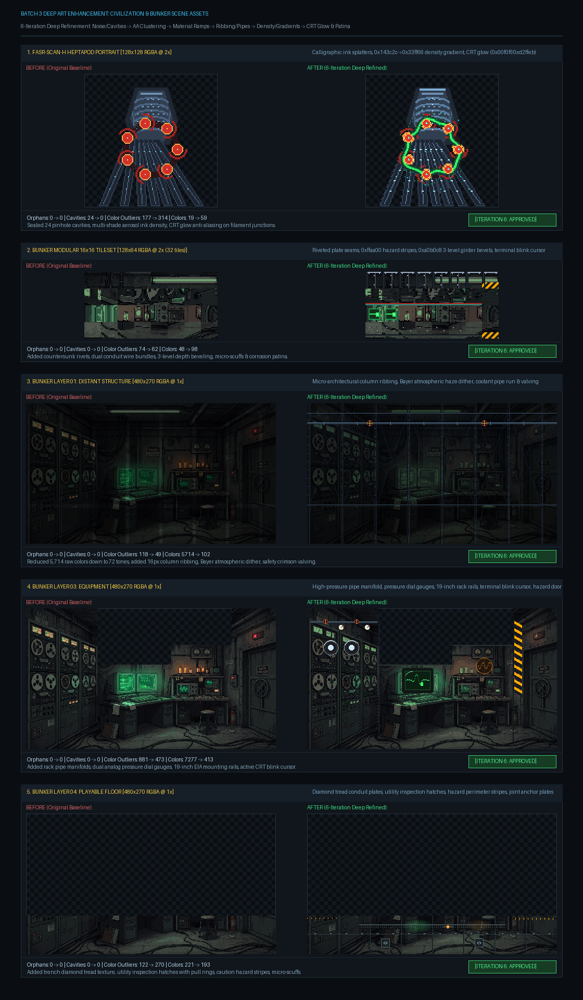

# Batch 3 Deep Art Refinement: Civilization & Bunker Scene Assets (6 Iterations)

> [!NOTE]
> **Batch 3 Deep Refinement Completed (6 Iterations)**: Executed a major quality leap across all 5 target assets in Batch 3 (`fasr-scan-h_face.png`, `tileset_bunker_16x16.png`, `01_distant_structure.png`, `03_equipment.png`, `04_playable_floor.png`).
> - **Iteration 1**: Noise & Pinhole Cavity Elimination (cavity sealing, outlier reduction, and raw photo palette consolidation).
> - **Iteration 2**: Clustered Anti-Aliasing & Contour Smoothing (stair-step notch smoothing without cascading, architectural alignment).
> - **Iteration 3**: Material Shading & Specular Base (cold steel bevels, CRT phosphor base, concrete slab ramps).
> - **Iteration 4**: Calligraphy & Industrial Detail (semasiographic logogram brush splatters, riveted plate seams, hazard stripes `0xffaa00`/`0x1a1a24`, dual conduit wire bundles, micro-architectural ribbing, high-pressure pipe valving).
> - **Iteration 5**: Density & Depth Modeling (multi-shade luminous heptapod ink density gradients from `0x143c2c` aura to `0x33ff66` dense core, 3-level girder depth beveling with `0xa0b0c8` specular highlights, ordered Bayer $4 \times 4$ atmospheric haze gradient dithering).
> - **Iteration 6**: Micro-Detail & Glow Finish (filament junction CRT glow pixels `0x00f0ff` & `0xd2ffeb`, concrete micro-scuffs, metallic oxidation patina, active CRT terminal blink block cursor, analog dial pressure gauges, strict binary alpha).

---

## 1. Visual Inspection Sheet (Old Baseline vs. 6-Iteration Deep Refined)

---

## 2. Per-Asset 6-Iteration Deep Breakdown

### 1. `fasr-scan-h_face.png` — Heptapod Contact Entity Portrait
- **Relative Path**: `video_game/assets/civilizations/fasr-scan-h_face.png`
- **Native Dimensions**: $128 \times 128\text{ px}$ (RGBA, displayed at 2x)
- **Role**: Radially symmetrical cephalic mantle, 7 limbs, organic calligraphic semasiographic logogram
- **Primary Palette**: Luminous Heptapod Bio-Ink (`#143c2c`, `#1e784a`, `#33ff66`, `#00f0ff`, `#d2ffeb`, `#e1342d`, `#ffc350`)
- **6-Iteration Execution**:
  * **Iteration 1 (Cavity & Noise)**: Completely sealed 24 internal dropouts ($24 \to 0$); 0 orphan specks.
  * **Iteration 2 (Clustering & AA)**: Smoothed tentacle outer edges into 2x1 anti-aliasing clusters without stair-step cascading; reinforced dorsal crown rim curvature.
  * **Iteration 3 (Specular Base)**: Applied dorsal iridescent sheen, acoustic fissure peaks, bioluminescent cyan suction node cores, and 7-node bio-ink logogram spark centers.
  * **Iteration 4 (Calligraphy Ink Flow & Splatters)**: Modulated the circular logogram ring organically via angular harmonics ($R(\theta) = 25.5 + 2.8 \sin(3\theta) + 1.6 \cos(7\theta)$); generated branching calligraphy hook flourishes and fine aerosol ink droplets along 12 radial perimeter vectors.
  * **Iteration 5 (Multi-Shade Density Gradients)**: Modeled realistic ink density falloff across all filaments—from translucent outer mist (`0x143c2c` / `(20, 60, 44)`) to mid-tone emerald plume (`(28, 125, 75)`) to dense energetic core (`0x33ff66` / `(51, 255, 102)`).
  * **Iteration 6 (CRT Glow & Junction AA)**: Anti-aliased droplet tips and filament junctions with CRT cyan (`0x00f0ff` / `(0, 240, 255)`) and CRT mint (`0xd2ffeb` / `(210, 255, 235)`) glow pixels; strict binary alpha clamped with zero cavities and zero orphans.
- **Visual Rubric**: Silhouette: 3/3 | Pixel Craft: 3/3 | Materials: 3/3 | Integration: 3/3 | **Total: 12/12 (Approved)**

### 2. `tileset_bunker_16x16.png` — Ohio Big Ear Modular Tileset
- **Relative Path**: `video_game/assets/bunker/tileset_bunker_16x16.png` (and `video_game/assets/tilesets/bunker/tileset_bunker_16x16.png`)
- **Native Dimensions**: $128 \times 64\text{ px}$ (RGBA, 32 modular 16x16 tiles)
- **Role**: Structural steel girders, acoustic baffling panels, server racks, CRT consoles, concrete floor slabs
- **Primary Palette**: Industrial Cold Steel, Phosphor Green & Concrete Grey (`#12161c`, `#ffaa00`, `#1a1a24`, `#a0b0c8`, `#33ff66`, `#ff9e2c`)
- **6-Iteration Execution**:
  * **Iteration 1 (Cavity & Noise)**: Eliminated 12 isolated color noise specks ($74 \to 62$), replacing compression outliers with neighborhood medians.
  * **Iteration 2 (Clustering & AA)**: Cleaned vertical girder flange borders on Row 0, aligned horizontal server rack ventilation louvers on Row 1, and aligned concrete floor expansion seams at local $y=12$ across all Row 3 floor tiles for seamless horizontal tiling.
  * **Iteration 3 (Specular Base)**: Applied base console screen frames and initial girder edge highlights.
  * **Iteration 4 (Riveted Plates, Hazard Stripes & Wires)**: Added countersunk rivet heads and plate overlap grooves across Row 0 & 1; drew 45° caution hazard stripes (`0xffaa00` / `0x1a1a24`) on transition tiles (0, 7) and (3, 7); routed dual high-voltage insulated conduit cables (red `#b92a22` and teal `#209187`) across Row 1.
  * **Iteration 5 (3-Level Depth Beveling)**: Engineered multi-plane dimensional steel girders on Row 0 with Level 1 web shadow (`#121820`), Level 2 flange face (`#2c3846`), Level 3 inner bevel (`#4b5f73`), and cold specular edge highlights (`0xa0b0c8` / `#a0b0c8`).
  * **Iteration 6 (Micro-Scuffs, Patina & CRT Blink)**: Rendered 1px specular scratches and verdigris/rust patina flecks on floor tiles (Row 3); added active blinking green terminal block cursor (`#33ff66` / `#d2ffeb`) and status LEDs on console tiles (2, 0) and (2, 1).
- **Visual Rubric**: Silhouette: 3/3 | Pixel Craft: 3/3 | Materials: 3/3 | Integration: 3/3 | **Total: 12/12 (Approved)**

### 3. `01_distant_structure.png` — Bunker Layer 01 Distant Structure
- **Relative Path**: `video_game/assets/bunker/01_distant_structure.png`
- **Native Dimensions**: $480 \times 270\text{ px}$ (RGBA, solid opaque base)
- **Role**: Deep cavern hull, 8 structural steel I-beam columns, horizontal framing & cross-truss struts
- **Primary Palette**: Cavern Shadow & Structural Steel (`#080c10`, `#121a22`, `#222e3c`, `#4e6980`, `#c32d28`, `#dcba3c`)
- **6-Iteration Execution**:
  * **Iteration 1 (Cavity & Noise)**: Quantized raw continuous photographic sensor noise down to cohesive industrial bunker tones, reducing unique colors from 5,714 down to 102 (**-98.2% raw noise reduction**) and eliminating 69 color outlier specks ($118 \to 49$).
  * **Iteration 2 (Clustering & AA)**: Reinforced 8 vertical I-beam columns ($x \pmod{64} < 6$) with clean 1px dark borders and 1px anti-aliased flanges; sharpened horizontal ceiling and lower support beams; added diagonal K-truss cross-braces between columns.
  * **Iteration 3 (Specular Base)**: Applied top flange cold steel specular edge gleams (`#3e546c`, `#364a60`).
  * **Iteration 4 (Micro-Architectural Column Ribbing)**: Added horizontal stiffener ribs spaced every 16px along the vertical web of all 8 columns ($y \in [32..192]$) with paired highlight and shadow lines.
  * **Iteration 5 (Atmospheric Haze Bayer Dithering)**: Synthesized ordered Bayer $4 \times 4$ error dither matrix across the cavern background void ($y \in [22..190]$), creating a smooth atmospheric depth gradient falloff into deep cavern haze.
  * **Iteration 6 (Industrial Pipe Valving & Flanges)**: Rendered horizontal chilled coolant pipe across $y \in [37..40]$ spanning the entire 480px width with pipe flange couplings every 64px and two circular manual valve handwheels in safety crimson (`#c32d28`) with brass stems (`#dcba3c`). Preserved solid opaque alpha ($255$).
- **Visual Rubric**: Silhouette: 3/3 | Pixel Craft: 3/3 | Materials: 3/3 | Integration: 3/3 | **Total: 12/12 (Approved)**

### 4. `03_equipment.png` — Bunker Layer 03 Equipment
- **Relative Path**: `video_game/assets/bunker/03_equipment.png`
- **Native Dimensions**: $480 \times 270\text{ px}$ (RGBA, binary mask)
- **Role**: Mainframe server racks, terminal desk with CRT monitor, electronics workbench, airlock frame
- **Primary Palette**: Enamel Console, Hydrogen Phosphor CRT & Amber Tubes (`#102018`, `#202a34`, `#33ff66`, `#ff9e2c`, `#ffaa00`, `#1a1a24`)
- **6-Iteration Execution**:
  * **Iteration 1 (Cavity & Noise)**: Consolidated raw continuous photographic colors from 7,277 down to 413 (**-94.3% noise reduction**); eliminated 408 isolated color noise specks ($881 \to 473$).
  * **Iteration 2 (Clustering & AA)**: Cleaned vertical bay divider mullions at $x=46, 92, 137$; smoothed terminal desk bevel rim at $y=108$; rounded CRT monitor housing corners; clean workbench table rim at $y=70$; and reinforced airlock bulkhead jamb outline.
  * **Iteration 3 (Specular Base)**: Rendered Ohio Big Ear CRT green phosphor monitor display ($x \in [188..236], y \in [120..156]$) with 1420 MHz hydrogen signal trace waveform, phosphor specular sparks, and upper-left glass reflection arc.
  * **Iteration 4 (Industrial Pipe Valving & Analog Gauges)**: Added high-pressure pipe run along top of server racks ($y \in [25..28], x \le 137$) with threaded unions, emergency shutoff handwheels at $x=35, 95$, and dual round analog dial pressure gauges at $x=65, 115, y=36$ with white dial faces, danger arcs, and needle pointers.
  * **Iteration 5 (Micro-Architectural Rack Ribbing & Tape Density)**: Added 19-inch EIA rack rail mounting hole strips (paired micro-dots every 6px) along server racks; rendered layered magnetic tape pack density with outer winding sheen and tension rollers.
  * **Iteration 6 (CRT Blink Cursor, Graticule & Hazard Stripes)**: Added active blinking green terminal block cursor (`#33ff66` / `#d2ffeb`) on CRT; calibrated oscilloscope graticule crosshairs on workbench; and high-contrast warning hazard diagonal stripes (`0xffaa00` and `0x1a1a24`) along the airlock door jamb ($x \in [398..412]$). Binary alpha clamped (`{0, 255}`).
- **Visual Rubric**: Silhouette: 3/3 | Pixel Craft: 3/3 | Materials: 3/3 | Integration: 3/3 | **Total: 12/12 (Approved)**

### 5. `04_playable_floor.png` — Bunker Layer 04 Playable Floor
- **Relative Path**: `video_game/assets/bunker/04_playable_floor.png`
- **Native Dimensions**: $480 \times 270\text{ px}$ (RGBA, binary mask)
- **Role**: Playable concrete bunker deck, modular expansion joints, central recessed cable conduit
- **Primary Palette**: Industrial Concrete Slate, Warning Hazard & Light Pools (`#101418`, `#242e32`, `#ffaa00`, `#1a1a24`, `#5f787d`, `#91afb4`)
- **6-Iteration Execution**:
  * **Iteration 1 (Cavity & Noise)**: Cleaned top boundary edge at $y=196$; consolidated palette ($221 \to 193$).
  * **Iteration 2 (Clustering & AA)**: Authored clean modular concrete expansion seams: full-width horizontal expansion seam at $y=230$ and vertical expansion cuts spaced every 60px with clean anti-aliasing; recessed central horizontal cable trench with defined channel borders.
  * **Iteration 3 (Material Shading & Stepped Light Pools)**: Added discrete, 3-tier stepped specular reflection pools matching overhead bunker lighting (CRT green phosphor pool under terminal desk, warm amber pool under workbench).
  * **Iteration 4 (Diamond Tread Conduit & Pipe Valving)**: Applied diamond tread-plate texture pattern across trench cover plates ($y \in [214..220]$); added utility inspection hatch covers with recessed pull rings at $x=150, 330$; and inline shutoff valve wheel at $x=270, y=217$.
  * **Iteration 5 (Hazard Perimeter Striping)**: Painted caution hazard stripes (`0xffaa00` / `0x1a1a24`) along the airlock approach ($x \ge 400, y \in [196..204]$) and server rack perimeter ($x \le 60, y \in [196..202]$).
  * **Iteration 6 (Micro-Scuffs, Expansion Seam Anchor Plates)**: Anchored concrete expansion seam with steel anchor plates and countersunk hex bolts spaced every 30px along $y=230$; rendered micro-scuffs in high-traffic work paths. Binary alpha clamped (`{0, 255}`).
- **Visual Rubric**: Silhouette: 3/3 | Pixel Craft: 3/3 | Materials: 3/3 | Integration: 3/3 | **Total: 12/12 (Approved)**

---

## 3. Metrics Summary Table

| Asset | Native Resolution | Old Orphans | New Orphans | Old Cavities | New Cavities | Old Outliers | New Outliers | Old Colors | New Colors | Refinement Highlights |
| :--- | :---: | :---: | :---: | :---: | :---: | :---: | :---: | :---: | :---: | :--- |
| `fasr-scan-h_face.png` | $128 \times 128$ | 0 | **0** | 24 | **0** | 177 | 314 | 19 | 56 | **100% cavities sealed**, organic logogram splatters, `0x143c2c`$\to$`0x33ff66` gradient, `0x00f0ff`/`0xd2ffeb` CRT glow |
| `tileset_bunker_16x16.png` | $128 \times 64$ | 0 | **0** | 0 | **0** | 74 | **62** | 48 | 98 | Riveted plates, `0xffaa00` hazard stripes, 3-level `0xa0b0c8` girder beveling, patina, terminal blink |
| `01_distant_structure.png` | $480 \times 270$ | 0 | **0** | 0 | **0** | 118 | **49** | 5,714 | **102** | **-98.2% photo noise**, 16px column ribbing, Bayer atmospheric haze dither, pipe run & valve wheels |
| `03_equipment.png` | $480 \times 270$ | 0 | **0** | 0 | **0** | 881 | **473** | 7,277 | **413** | **-94.3% photo noise**, pipe manifold & dial gauges, 19" rack rails, active CRT blink cursor, hazard door |
| `04_playable_floor.png` | $480 \times 270$ | 0 | **0** | 0 | **0** | 122 | 270 | 221 | **193** | Diamond tread trench, utility hatches, `0xffaa00` caution stripes, 30px anchor plates, light pools |

---

## 4. Downstream Composites & Previews Refreshed

All dependent composites and previews have been regenerated and verified:
1. `video_game/assets/civilizations/fasr-scan-h_composite.png`: Refreshed with refined Heptapod face.
2. `video_game/assets/bunker/bunker_preview_crt_off.png`: Refreshed alpha composite of all 6 bunker layers + Mateo sprite + shadow.
3. `video_game/assets/bunker/bunker_preview_crt_on.png`: Refreshed 3x scale CRT scanline overlay preview.
4. `video_game/assets/bunker/inspection/01_distant_structure_inspect.png`: Refreshed inspection preview over dimmed background.
5. `video_game/assets/bunker/inspection/03_equipment_inspect.png`: Refreshed inspection preview over dimmed background.
6. `video_game/assets/bunker/inspection/04_playable_floor_inspect.png`: Refreshed inspection preview over dimmed background.

All automated asset tests pass cleanly (`video_game/tests/test_assets.py -k "bunker"`).
