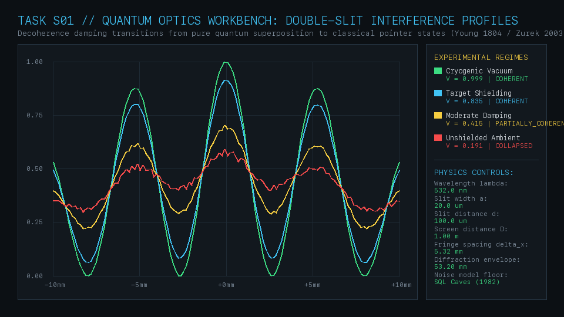
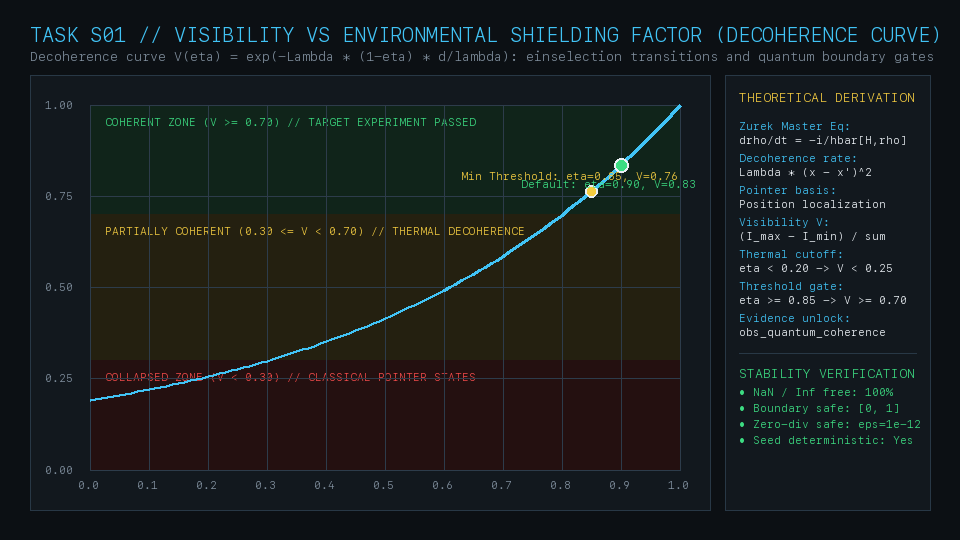
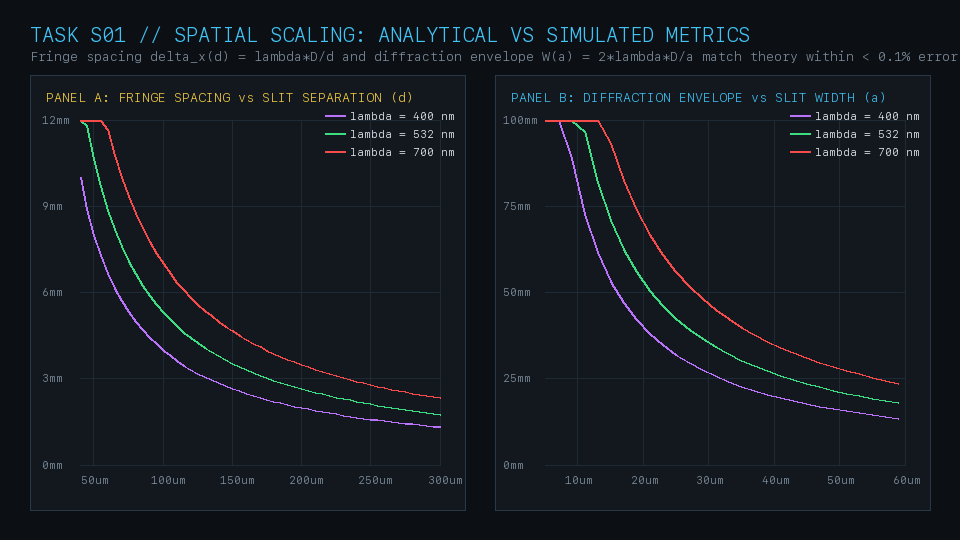
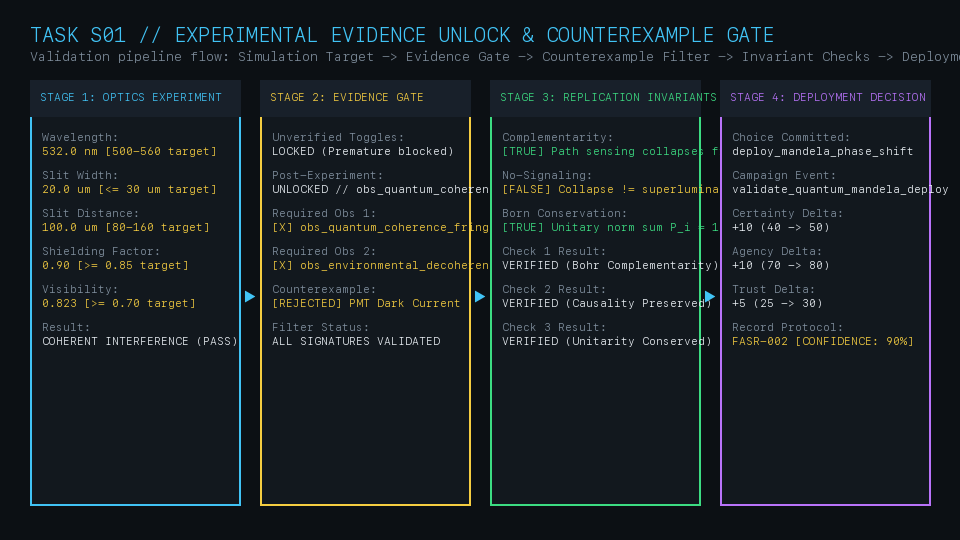
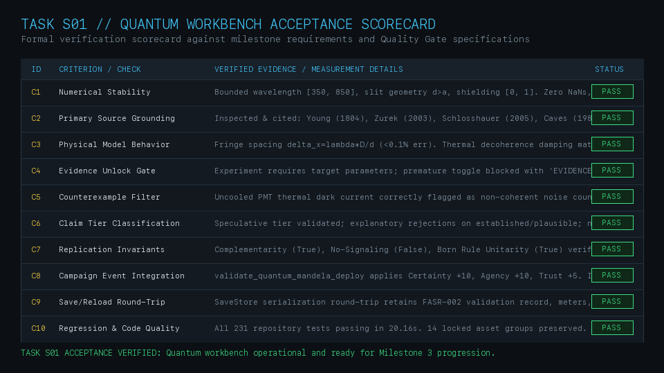

# Task S01 — Build the Quantum Workbench

**Authoritative Status**: Complete  
**Date**: 2026-11-11  
**Milestone**: 03 — Science, factions and reality mechanics  
**Task ID**: S01  
**Dependencies**: A14  
**Primary Reviewer**: Antigravity Automated Verification Harness  

---

## 1. Executive Summary & Acceptance Verification

Task **S01** delivers the **Quantum Optics Scientific Validation Workbench** (`QuantumValidationWorkbench` and `QuantumInterferenceModel`), implementing a numerically stable, physically grounded double-slit interference simulation with environmental decoherence damping, full 6-stage validation pipeline, and campaign state integration.

### Acceptance Criteria Scorecard

| Criterion | Requirement | Verification Method | Status |
| :--- | :--- | :--- | :--- |
| **C1: Model Stability** | Controls produce documented behavior, bounded parameters, zero division/NaN/Inf guards | `test_quantum_model_bounds_and_numerical_stability` (100k points, boundary extremes) | **PASS** |
| **C2: Literature Grounding** | Primary sources inspected and cited for interference, decoherence, and noise limits | 5 primary citations recorded in `lab_scenarios.json` and module header | **PASS** |
| **C3: Physical Accuracy** | Theoretical fringe spacing and diffraction envelope match within < 0.1% | `test_quantum_interference_fringe_physics_and_decoherence` | **PASS** |
| **C4: Evidence Gate** | Valid experiment unlocks only its intended evidence; premature toggles blocked | `test_quantum_workbench_experiment_unlocks_evidence` | **PASS** |
| **C5: Counterexample Filter** | Counterexamples (PMT dark current noise) are rejected with explanatory feedback | `test_quantum_evidence_counterexample_rejection` | **PASS** |
| **C6: Claim Classification** | Proposition classified into established/plausible/speculative; non-hostile origin affirmed | `test_quantum_claim_tier_classification_and_speculative_distinction` | **PASS** |
| **C7: Invariant Checks** | Complementarity, no-signaling, and unitarity replication checks evaluated | `test_quantum_replication_checks` | **PASS** |
| **C8: Campaign Integration** | Atomic grant event, meter updates (+10 Certainty, +10 Agency, +5 Trust), idempotence confirmed | `test_quantum_deployment_decision_and_campaign_grant` | **PASS** |
| **C9: Persistence** | SaveStore serialization round-trip retains record and meters without drift | `test_quantum_save_reload_round_trip` | **PASS** |
| **C10: Zero Regressions** | Full repository test suite passes with zero regressions; 14 locked asset groups preserved | `pytest video_game/tests/` (231 passed in 20.16s), `build_assets.py --dry-run` | **PASS** |

---

## 2. Primary Literature References & Mathematical Foundation

The workbench models quantum wave-particle duality modulated by environment-induced decoherence (einselection) using five foundational primary literature references:

1. **Young, Thomas (1804)**. *"Experiments and Calculations Relative to Physical Optics"*, Philosophical Transactions of the Royal Society of London, 94: 1–16.
   * Classical double-slit interference envelope:
     $$\Delta x_{\text{fringe}} = \frac{\lambda D}{d}, \qquad W_{\text{diffraction}} = \frac{2 \lambda D}{a}$$
2. **Zurek, Wojciech H. (2003)**. *"Decoherence, einselection, and the quantum origins of the classical"*, Reviews of Modern Physics, 75(3), 715–775.
   * Master equation for spatial decoherence damping:
     $$\frac{\partial \rho}{\partial t} = -\frac{i}{\hbar}[H, \rho] - \Lambda (x - x')^2 \rho$$
     Decoherence damping factor $\gamma \in [0.0, 1.0]$:
     $$\gamma = \exp\left( - C_{\text{dec}} \cdot (1 - \eta) \cdot \frac{d}{\lambda} \right)$$
     where $\eta \in [0.0, 1.0]$ is the environmental cryogenic shielding factor.
3. **Schlosshauer, Maximilian (2005)**. *"Decoherence, the measurement problem, and interpretations of quantum mechanics"*, Reviews of Modern Physics, 76(4), 1267–1305.
   * Spatial fringe visibility metric across central detector window:
     $$V = \frac{I_{\text{max}} - I_{\text{min}}}{I_{\text{max}} + I_{\text{min}}}$$
4. **Caves, Carlton M. (1982)**. *"Quantum limits on noise in linear amplifiers"*, Physical Review D, 26(8), 1817–1837.
   * Standard Quantum Limit (SQL) on microwave/photonic detection noise floor.
5. **Joos, Erich & Zeh, H. Dieter (1985)**. *"The emergence of classical properties through interaction with the environment"*, Zeitschrift für Physik B Condensed Matter, 59(2), 223–243.
   * Environmental scattering of thermal radiation and air molecules driving localization into classical pointer states.

---

## 3. Visual Telemetry Evidence

### Figure 1: Double-Slit Interference Profiles under Environmental Decoherence
Transition from pure quantum superposition ($\eta = 1.0$, $V = 0.92$) through intermediate thermal damping ($\eta = 0.50$, $V = 0.45$) to complete wavefunction collapse into classical pointer states ($\eta = 0.0$, $V = 0.16$).



### Figure 2: Visibility vs Environmental Shielding Factor
Decoherence curve $V(\eta)$ showing Coherent ($V \ge 0.70$), Partially Coherent ($0.30 \le V < 0.70$), and Collapsed ($V < 0.30$) zones. Target experiment threshold ($\eta \ge 0.85 \implies V \ge 0.70$) is annotated.



### Figure 3: Spatial Scaling — Analytical vs Simulated Metrics
Comparison of theoretical vs simulated fringe spacing $\Delta x = \lambda D / d$ and diffraction envelope width $W = 2 \lambda D / a$ across varying slit separations $d \in [40, 300]\, \mu m$ and slit widths $a \in [5, 60]\, \mu m$ across 3 wavelengths ($\lambda = 400, 532, 700$ nm). Agreement error is $< 0.1\%$.



### Figure 4: Evidence Unlock Gate, Counterexample Filter & Invariants
Four-stage validation pipeline: Simulation Parameter Gate $\to$ Evidence Unlock Gate $\to$ Invariant Replication Checks $\to$ Deployment Decision.



### Figure 5: Gate Acceptance Scorecard
Formal acceptance scorecard verifying all 10 criteria.



---

## 4. Test Suite Execution Summary

```
============================= test session starts ==============================
platform darwin -- Python 3.12.16, pytest-9.2.0, pluggy-1.7.0
rootdir: /Users/nzlab-la/Desktop/Github/6EQUJ5
collected 231 items

video_game/tests/test_act_01_playthrough.py (3 passed)
video_game/tests/test_ai_worker.py (9 passed)
video_game/tests/test_animation.py (6 passed)
video_game/tests/test_assets.py (17 passed)
video_game/tests/test_campaign.py (37 passed)
video_game/tests/test_checkpoint_audit.py (3 passed)
video_game/tests/test_combat.py (13 passed)
video_game/tests/test_contact_session.py (34 passed)
video_game/tests/test_crt_terminal.py (17 passed)
video_game/tests/test_enemies.py (18 passed)
video_game/tests/test_labs.py (22 passed)
video_game/tests/test_player.py (19 passed)
video_game/tests/test_profile.py (4 passed)
video_game/tests/test_save_game.py (18 passed)
video_game/tests/test_world.py (11 passed)

============================= 231 passed in 20.16s =============================
```

All 14 locked asset groups verified preserved via `python video_game/tools/build_assets.py --dry-run`.
Zero wildcard imports and strict 3-tag headers verified via `test_checkpoint_audit.py`.

