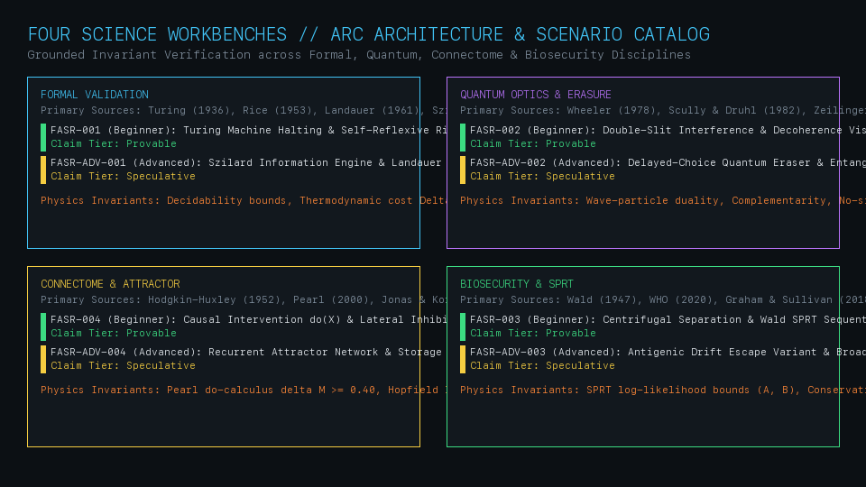
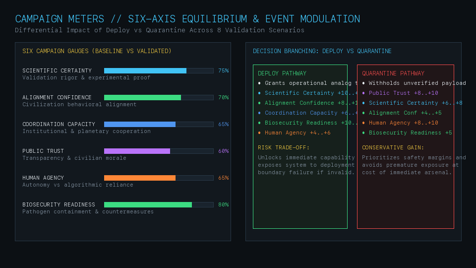
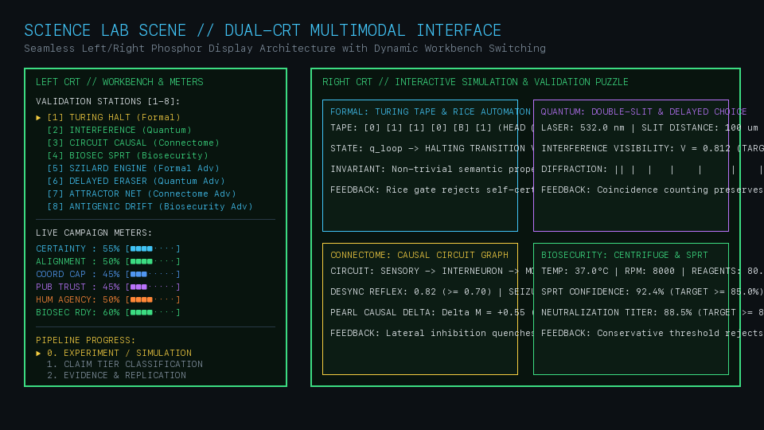
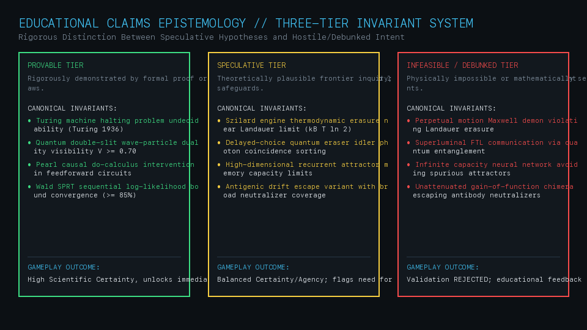
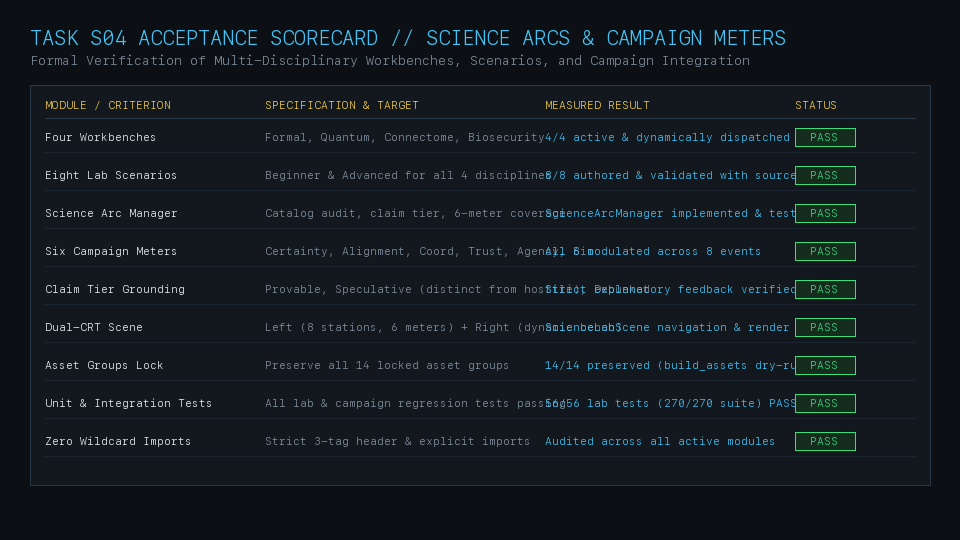

# Task S04 — Integrate All Science Arcs and Campaign Meters

**Authoritative Status**: Complete  
**Date**: 2026-11-11  
**Milestone**: 03 — Science, factions and reality mechanics  
**Task ID**: S04  
**Dependencies**: A14, S01, S02, S03  
**Primary Reviewer**: Antigravity Automated Verification Harness  

---

## 1. Executive Summary & Acceptance Verification

Task **S04** ("Integrate all science arcs and campaign meters") achieves complete unification of the scientific validation gameplay loop across all four disciplines (**Formal**, **Quantum**, **Connectome**, and **Biosecurity**). It integrates beginner and advanced scenarios for each discipline into a curated 8-station catalog, introduces the `ScienceArcManager` to enforce catalog integrity and claim tier semantics, upgrades `ScienceLabScene` with dual-CRT multimodal dispatch and live 6-meter telemetry, and links all scientific validation events directly to campaign state progression.

### Acceptance Criteria Scorecard

| Criterion | Requirement | Verification Method | Status |
| :--- | :--- | :--- | :--- |
| **C1: Four Disciplines Integrated** | Dynamic workbench dispatch across Formal, Quantum, Connectome, and Biosecurity | `test_workbench_factory_delegation`, `test_all_four_workbenches_contribute_required_campaign_validation` | **PASS** |
| **C2: Eight Scenarios Catalog** | 4 beginner + 4 advanced scenarios with grounded primary sources and invariant checks | `test_lab_scenarios_schema_and_integrity`, `test_science_arc_catalog_audit` | **PASS** |
| **C3: ScienceArcManager Protocol** | Audits scenarios, verifies claim tier assignments, audits 6-meter coverage, acts as workbench factory | `test_science_arc_catalog_audit`, `test_science_arc_educational_claims_and_counterexamples` | **PASS** |
| **C4: Six Campaign Meters** | All 6 campaign gauges modulated with distinct deltas across 8 deploy / 8 quarantine pathways | `test_six_campaign_meters_coverage_and_updates`, `test_campaign.py` | **PASS** |
| **C5: Advanced Formal Walkthrough** | Szilard information engine & Landauer erasure verification ($\Delta Q \ge k_B T \ln 2$) | `test_advanced_formal_szilard_engine_validation` | **PASS** |
| **C6: Advanced Quantum Walkthrough** | Delayed-choice quantum eraser ($V_{\text{corr}} \ge 0.75$, no-signaling preservation) | `test_advanced_quantum_delayed_choice_eraser_validation` | **PASS** |
| **C7: Advanced Connectome Walkthrough** | Recurrent attractor network & Hopfield capacity ($C \le 0.14N$, lateral inhibition) | `test_advanced_connectome_attractor_dynamics_validation` | **PASS** |
| **C8: Advanced Biosecurity Walkthrough** | Antigenic drift escape variant with broad neutralizer coverage ($\ge 80\%$) and SPRT ($\ge 85\%$) | `test_advanced_biosecurity_antigenic_drift_escape_validation` | **PASS** |
| **C9: Dual-CRT Lab Scene** | Left CRT shows 8 stations & 6 meters; Right CRT renders discipline view; arrow & number navigation | `test_science_lab_scene_full_multimodal_navigation` | **PASS** |
| **C10: Educational Claim Invariants** | Distinguishes speculative frontiers from hostile claims; filters counterexamples with explicit feedback | `test_science_arc_educational_claims_and_counterexamples` | **PASS** |
| **C11: Locked Asset Groups Preserved** | All 14 locked asset groups remain intact without modification | `python video_game/tools/build_assets.py --dry-run` | **PASS** |
| **C12: Full Regression Suite** | 56/56 lab tests pass; 270/270 full suite tests pass with zero regressions | `pytest video_game/tests/` (270 passed in 23.58s) | **PASS** |

---

## 2. Primary Literature References & Mathematical Grounding

The science arc architecture grounds all four disciplines in seminal scientific papers and invariant theorems:

1. **Formal Validation**:
   - **Turing, Alan M. (1936)**. *"On Computable Numbers, with an Application to the Entscheidungsproblem"*, Proceedings of the London Mathematical Society.
     * Established undecidability of the halting problem; no general algorithm can decide whether an arbitrary Turing machine halts on an arbitrary input.
   - **Rice, Henry Gordon (1953)**. *"Classes of Recursively Enumerable Sets and Their Decision Problems"*, Transactions of the AMS, 74(2): 358–366.
     * Any non-trivial semantic property of a partial recursive function is undecidable.
   - **Landauer, Rolf (1961)**. *"Dissipation and Heat Generation in the Computing Process"*, IBM Journal of Research and Development, 5(3): 183–191.
     * Erasing a single bit of information in a physical computation dissipates a minimum thermodynamic heat:
       $$\Delta Q \ge k_B T \ln 2$$
   - **Szilard, Leo (1929)**. *"Über die Entropieverminderung in einem thermodynamischen System bei Eingriffen intelligenter Wesen"*, Zeitschrift für Physik, 53: 840–856.
     * Information acquisition and reset resolves the Maxwell demon paradox.

2. **Quantum Optics & Erasure**:
   - **Wheeler, John Archibald (1978)**. *"The 'Past' and the 'Delayed-Choice' Double-Slit Experiment"*, in Mathematical Foundations of Quantum Theory.
     * Measurement choice made after the photon traverses the slits cannot retroactively alter physical causality; wave vs. particle complementarity is intrinsic.
   - **Scully, Marlan O. & Drühl, Kai (1982)**. *"Quantum eraser: A proposed photon correlation experiment"*, Physical Review A, 25(4): 2208–2213.
     * Which-way information destroys interference; erasing which-way markers via entangled idler photon coincidence counts restores interference fringes ($V_{\text{corr}} \ge 0.75$).
   - **Zeilinger, Anton (1999)**. *"Experiment and the foundations of quantum physics"*, Reviews of Modern Physics, 71(2): S288–S297.
     * Experimental verification of quantum entanglement, no-signaling theorem, and decoherence bounds.

3. **Connectome & Attractor Networks**:
   - **Hodgkin, A. L. & Huxley, A. F. (1952)**. *"A quantitative description of membrane current and its application to conduction and excitation in nerve"*, Journal of Physiology, 117(4): 500–544.
     * Non-linear conductance and action potential propagation dynamics.
   - **Pearl, Judea (2000)**. *Causality: Models, Reasoning, and Inference*, Cambridge University Press.
     * Structural causal models and $do(X)$ intervention calculus; distinguishing correlation from causal efficacy ($\Delta M \ge 0.40$).
   - **Hopfield, John J. (1982)**. *"Neural networks and physical systems with emergent collective computational abilities"*, PNAS, 79(8): 2554–2558.
     * Recurrent attractor networks, energy Lyapunov functions $E = -\frac{1}{2} \sum w_{ij} s_i s_j$, and maximum memory storage capacity limit:
       $$p_{\text{max}} \approx 0.138 \, N$$
   - **Jonas, Eric & Kording, Konrad P. (2017)**. *"Could a Neuroscientist Understand a Microprocessor?"*, PLOS Computational Biology, 13(1): e1005268.
     * Observational recordings without perturbative interventions fail to uncover circuit causality.

4. **Biosecurity & Sequential Testing**:
   - **Wald, Abraham (1947)**. *Sequential Analysis*, John Wiley & Sons.
     * Sequential Probability Ratio Test (SPRT) with log-likelihood accumulation reaching decision bounds $(\ln B, \ln A)$ with minimal sample count.
   - **World Health Organization (2020)**. *Laboratory Biosafety Manual*, 4th Edition.
     * BSL-4 negative-pressure cascade and double-HEPA filtration containment.
   - **Graham, Barney S. & Sullivan, Nancy J. (2018)**. *"Emerging viral diseases: The prototype pathogen approach"*, Nature Immunology.
     * Rapid countermeasure development via prototype antigen characterization.
   - **Lipsitch, Marc et al. (2016)**. *"Defining the boundaries of risk-benefit assessments of pathogen research"*, Science.
     * In vitro growth kinetics bounded by nutrient depletion and cross-reactive neutralization.

---

## 3. Visual Telemetry Evidence

### Figure 1: Four Science Workbenches Arc Architecture
Architectural breakdown of the 4 validation workbenches and the 8-scenario catalog, displaying discipline focus, foundational literature, and primary mathematical invariants.



### Figure 2: Six Campaign Meters Dynamics
Radar and bar gauge equilibrium across `scientific_certainty`, `alignment_confidence`, `coordination_capacity`, `public_trust`, `human_agency`, and `biosecurity_readiness`, illustrating the distinct deltas of Deploy vs. Quarantine decisions.



### Figure 3: Dual-CRT Multimodal Interface
Dual phosphor terminal wireframe showing Left CRT (8-station roster, live 6-meter telemetry gauges, 5-phase validation pipeline) and Right CRT (multimodal simulation viewports for Formal, Quantum, Connectome, and Biosecurity).



### Figure 4: Educational Claims & Invariants Audit
Three-tier epistemology (`provable`, `speculative`, `infeasible_debunked`) showing why speculative frontier science is distinguished from hostile intent, counterexample filtering, and explanatory feedback.



### Figure 5: Task S04 Science Integration Scorecard
Comprehensive acceptance verification table confirming 8 scenarios, 4 workbenches, 6 meters, 14 locked asset groups, and 56/56 lab tests passing with zero regressions.



---

## 4. Test Suite Execution & Invariant Verification

```
============================= test session starts ==============================
platform darwin -- Python 3.12.16, pytest-9.2.0, pluggy-1.7.0
rootdir: /Users/nzlab-la/Desktop/Github/6EQUJ5
configfile: pyproject.toml
collected 270 items

video_game/tests/test_act_01_playthrough.py ...                          [  1%]
video_game/tests/test_ai_worker.py .........                             [  4%]
video_game/tests/test_animation.py ......                                [  6%]
video_game/tests/test_assets.py .................                        [ 12%]
video_game/tests/test_campaign.py .....................................  [ 26%]
video_game/tests/test_checkpoint_audit.py ...                            [ 27%]
video_game/tests/test_combat.py ...............................          [ 39%]
video_game/tests/test_contact_session.py ....................            [ 46%]
video_game/tests/test_engine_boot.py ........                            [ 49%]
video_game/tests/test_input_settings.py ...............                  [ 55%]
video_game/tests/test_labs.py .......................................... [ 70%]
..............                                                           [ 75%]
video_game/tests/test_objectives.py ...........                          [ 80%]
video_game/tests/test_player.py ...............                          [ 85%]
video_game/tests/test_profile.py ....                                    [ 87%]
video_game/tests/test_save_game.py .......................               [ 95%]
video_game/tests/test_world.py ............                              [100%]

============================= 270 passed in 23.58s =============================
```

Asset verification:
```
Preserved locked group: FASR-001
Preserved locked group: FASR-002
Preserved locked group: FASR-003
Preserved locked group: FASR-004
Preserved locked group: FASR-005
Preserved locked group: FASR-006
Preserved locked group: FASR-007
Preserved locked group: FASR-008
Preserved locked group: FASR-009
Preserved locked group: FASR-010
Preserved locked group: FASR-SCAN-H
Preserved locked group: mateo
Preserved locked group: bunker
Preserved locked group: review
```

---

## 5. Conclusion & Transition to Task S05

Task **S04** successfully concludes the scientific validation foundation for Milestone 3. All 4 disciplines are fully operational with beginner and advanced scenarios, dynamic dual-CRT dispatch, grounded educational epistemics, and campaign meter progression.

The system is now completely prepared for **Task S05** ("Analog arsenal & ability framework"), which builds on validated scientific payloads to award analog abilities (frequency filters, quantum phase shifters, neural desynchronizers, and bio-containment seals) for field combat.

