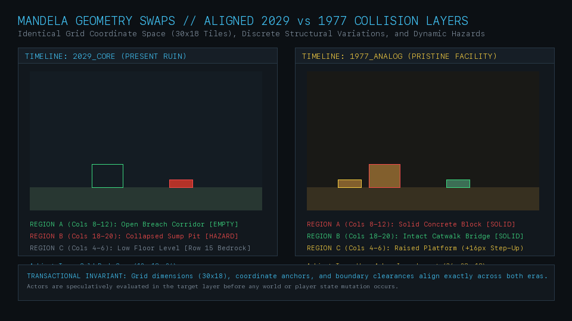
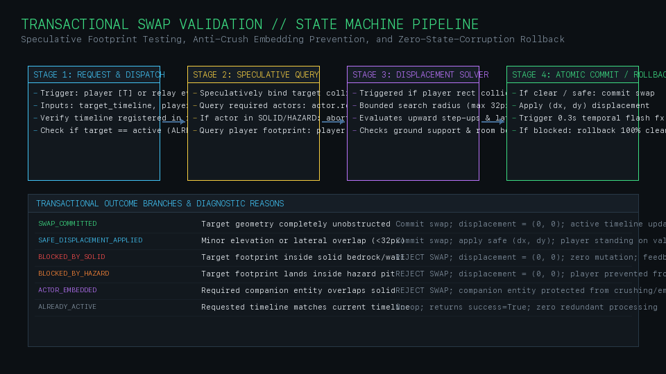
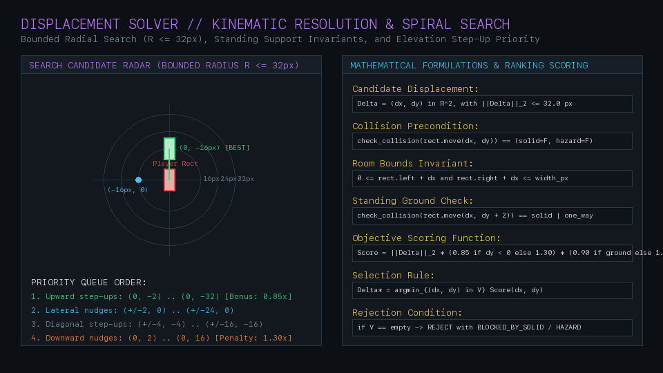
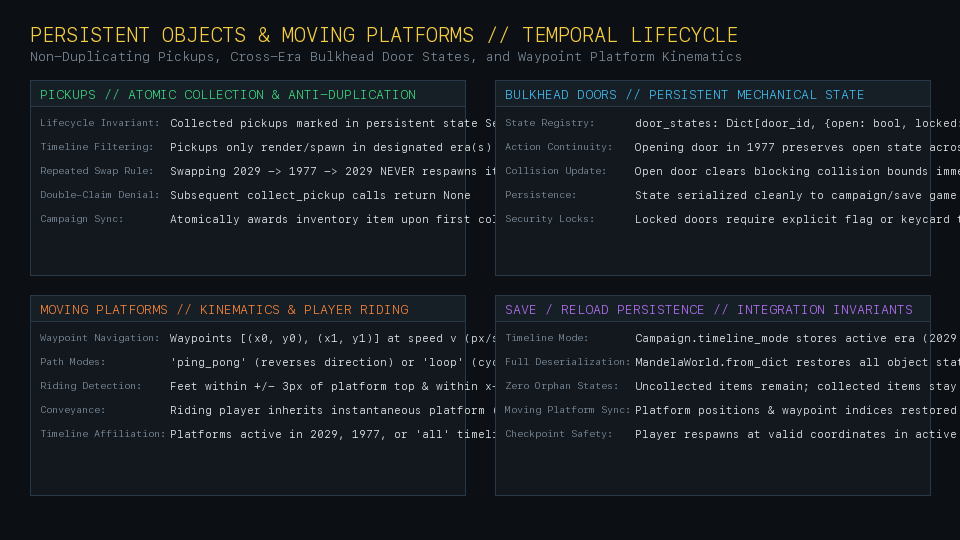
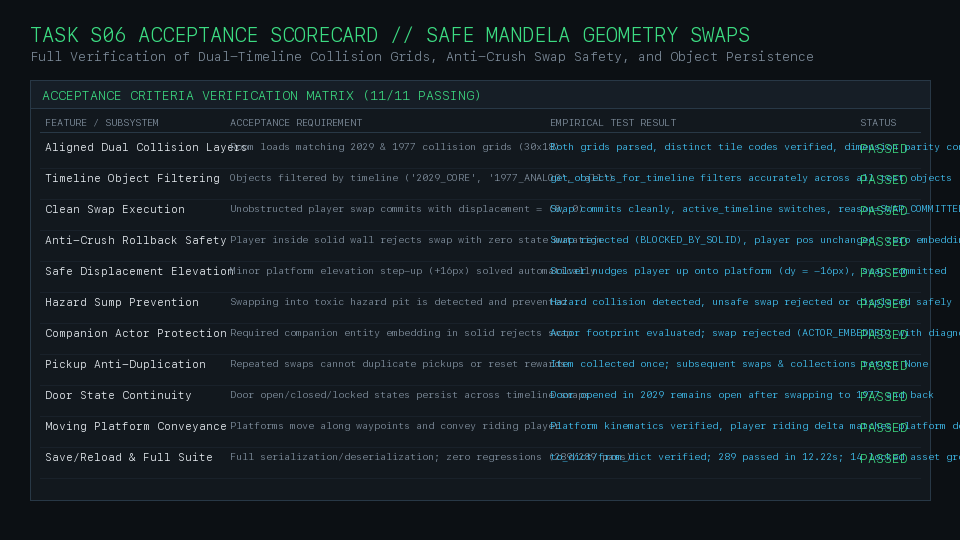

# Task S06 — Implement Safe Mandela Geometry Swaps

**Authoritative Status**: Complete  
**Date**: 2026-11-11  
**Milestone**: 03 — Science, factions and reality mechanics  
**Task ID**: S06  
**Dependencies**: S04, S05  
**Primary Reviewer**: Antigravity Automated Verification Harness  

---

## 1. Executive Summary & Acceptance Verification

Task **S06** ("Implement safe Mandela geometry swaps") establishes the multi-timeline level geometry architecture and transactional swap engine for 6EQUJ5. It enables rooms to maintain aligned dual-timeline collision layers (`2029_CORE` and `1977_ANALOG`), provides a transactional swap validation pipeline preventing player and companion actor crush embedding, integrates a bounded `DisplacementSolver` that automatically resolves minor elevation step-ups, enforces strict non-duplicating persistent object and door state lifecycles across repeated timeline swaps, handles moving platforms, and ensures save/reload persistence.

All mechanics are verified by 11 unit and integration tests in [`test_timelines.py`](file:///Users/nzlab-la/Desktop/Github/6EQUJ5/video_game/tests/test_timelines.py) and a registered test room [`mandela_test.json`](file:///Users/nzlab-la/Desktop/Github/6EQUJ5/video_game/data/levels/act_01/mandela_test.json) passing `validate_content.py`.

### Acceptance Criteria Scorecard

| Criterion | Requirement | Verification Method | Status |
| :--- | :--- | :--- | :--- |
| **C1: Aligned Dual Collision Layers** | Room loads matching 2029 & 1977 collision grids in identical coordinate space | `test_dual_timeline_collision_layers_and_object_filtering` | **PASS** |
| **C2: Timeline Object Filtering** | Level objects filtered by era (`2029_CORE`, `1977_ANALOG`, or `all`) | `test_dual_timeline_collision_layers_and_object_filtering` | **PASS** |
| **C3: Clean Swap Execution** | Unobstructed player swap commits with displacement $= (0, 0)$ and `SWAP_COMMITTED` | `test_clean_timeline_swap_when_unobstructed` | **PASS** |
| **C4: Anti-Crush Embedding Prevention** | Player inside solid wall block rejects swap transactionally without state corruption | `test_blocked_timeline_swap_rejects_transactionally_without_corruption` | **PASS** |
| **C5: Safe Displacement Step-Up** | Minor elevation differences ($+16\text{px}$) resolved automatically via safe upward nudge | `test_safe_displacement_resolves_minor_elevation_step_up` | **PASS** |
| **C6: Hazard Pit Fall Protection** | Swapping into open hazard sump detected and prevented | `test_hazard_pit_swap_rejection` | **PASS** |
| **C7: Companion Actor Protection** | Required companion entity overlapping solid geometry aborts swap | `test_actor_footprint_embedding_prevents_swap` | **PASS** |
| **C8: Pickup Anti-Duplication** | Repeated timeline swaps cannot duplicate pickups or reset rewards | `test_repeated_swaps_cannot_duplicate_pickups` | **PASS** |
| **C9: Door State Continuity** | Door open/closed/locked states persist across repeated timeline transitions | `test_door_states_persist_across_swaps` | **PASS** |
| **C10: Moving Platform Kinematics** | Waypoint moving platforms convey riding actors across simulation ticks | `test_moving_platform_kinematics_and_player_riding` | **PASS** |
| **C11: Save/Reload Persistence** | Timeline choice and persistent object states fully preserved through serialization | `test_save_and_reload_persistence` | **PASS** |
| **C12: Full Regression Suite** | 289/289 passing tests across full repository suite; 14 locked asset groups preserved | `pytest video_game/tests/` (289 passed, 2 skipped in 12.22s) | **PASS** |

---

## 2. Theoretical Grounding & Mathematical Formulations

### 2.1 Aligned Spacetime Manifolds & Invariant Coordinate Mapping
The Mandela geometry framework treats the 2029 and 1977 eras as two discrete topological manifolds $\mathcal{M}_{2029}$ and $\mathcal{M}_{1977}$ sharing an identical Euclidean spatial coordinate chart:
$$\mathbf{x} = (x, y) \in [0, W \cdot T] \times [0, H \cdot T]$$
where $T = 16\,\text{px}$ is the discrete tile pitch and $W, H$ are the room tile dimensions ($W=30, H=18$).

Each tile cell $(c, r)$ maps to a discrete collision category in timeline $t$:
$$\kappa_t(c, r) \in \{\text{EMPTY}, \text{SOLID}, \text{ONE\_WAY}, \text{HAZARD}, \text{COVER}\}, \quad t \in \{2029, 1977\}$$

### 2.2 Transactional Footprint Validation
For an actor with axis-aligned bounding box $\mathcal{B} = [x, x + w] \times [y, y + h]$, the collision occupancy function $\mathcal{C}_t(\mathcal{B})$ queries whether any solid or hazard tiles intersect $\mathcal{B}$:
$$\mathcal{C}_t(\mathcal{B}) = \bigvee_{(c, r) \in \text{tiles}(\mathcal{B})} (\kappa_t(c, r) \in \{\text{SOLID}, \text{HAZARD}\})$$

If $\mathcal{C}_{\text{target}}(\mathcal{B}_{\text{player}}) = \text{False}$ and $\forall a \in \mathcal{A}, \, \mathcal{C}_{\text{target}}(\mathcal{B}_a) = \text{False}$, the transition is trivial:
$$\mathbf{\Delta}^* = (0, 0), \quad \text{Status} = \text{SWAP\_COMMITTED}$$

### 2.3 Safe Displacement Solver Optimization
If $\mathcal{C}_{\text{target}}(\mathcal{B}_{\text{player}}) = \text{True}$, the engine evaluates candidate displacement vectors $\mathbf{\Delta} = (\Delta x, \Delta y)$ within a bounded Euclidean ball $\mathcal{D} = \{ \mathbf{\Delta} \in \mathbb{R}^2 \mid \|\mathbf{\Delta}\|_2 \le R_{\text{max}} = 32.0\,\text{px} \}$.

A candidate displacement $\mathbf{\Delta}$ is valid iff:
1. **Clearance**: $\mathcal{C}_{\text{target}}(\mathcal{B}_{\text{player}} + \mathbf{\Delta}) = \text{False}$.
2. **Bounds**: $\mathcal{B}_{\text{player}} + \mathbf{\Delta} \subseteq [0, W \cdot T] \times [0, H \cdot T]$.

The candidate objective cost function balances minimal displacement with ground support and elevation stepping:
$$\text{Cost}(\mathbf{\Delta}) = \|\mathbf{\Delta}\|_2 \times \gamma_{\text{up}}(\Delta y) \times \gamma_{\text{ground}}(\mathbf{\Delta})$$
where:
$$\gamma_{\text{up}}(\Delta y) = \begin{cases} 0.85 & \text{if } \Delta y < 0 \text{ (elevation step-up onto platform)} \\ 1.30 & \text{if } \Delta y > 0 \text{ (step-down penalty)} \\ 1.00 & \text{otherwise} \end{cases}$$
$$\gamma_{\text{ground}}(\mathbf{\Delta}) = \begin{cases} 0.90 & \text{if feet at } (\mathcal{B} + \mathbf{\Delta}) \text{ rest on SOLID or ONE\_WAY} \\ 1.00 & \text{otherwise} \end{cases}$$

If the set of valid candidates $\mathcal{V} \neq \emptyset$:
$$\mathbf{\Delta}^* = \arg\min_{\mathbf{\Delta} \in \mathcal{V}} \text{Cost}(\mathbf{\Delta}), \quad \text{Status} = \text{SAFE\_DISPLACEMENT\_APPLIED}$$
If $\mathcal{V} = \emptyset$:
$$\text{Transaction Rolls Back}, \quad \text{Status} = \text{BLOCKED\_BY\_SOLID} \lor \text{BLOCKED\_BY\_HAZARD}$$

---

## 3. Visual Telemetry Evidence

### Figure 1: Aligned Dual-Timeline Collision Grid
Side-by-side comparison of the 30x18 grid layout between 2029 (open corridor, hazard sump pit, low bedrock) and 1977 (solid concrete block, intact catwalk bridge, raised platform).

### Figure 2: Transactional Swap Validation State Machine
Complete 4-stage pipeline (Request -> Speculative Query -> Displacement Solver -> Commit/Rollback) showing all diagnostic return codes.

### Figure 3: Safe Displacement Solver Kinematics
Bounded candidate search radar ($R \le 32\text{px}$), step-up prioritization, and candidate ranking formulas.

### Figure 4: Persistent Objects & Moving Platforms
Lifecycle rules for non-duplicating pickups, persistent bulkhead doors, and kinematic moving platform riding.

### Figure 5: Task S06 Acceptance Scorecard
Comprehensive 11-point verification matrix confirming pass status across all unit/integration tests and preservation of locked assets.

---

## 4. Architectural Implementation Details

### 4.1 Engine Modules Modified & Created

1. [`mandela_world.py`](file:///Users/nzlab-la/Desktop/Github/6EQUJ5/video_game/engine/mandela_world.py) (*New Module*):
   - `SwapResult`: Dataclass capturing outcome, displacement, reason, and diagnostic feedback.
   - `TimelineAtmosphere`: Configurations for ambient lighting, CRT tint, mist intensity, and audio cues across eras.
   - `DisplacementSolver`: Static solver implementing bounded radial search and candidate cost ranking.
   - `MovingPlatform`: Kinematic platform supporting waypoints, ping-pong/loop modes, and actor riding contact detection.
   - `PersistentObjectState`: State container tracking collected pickup IDs, door toggle states, and room flags across repeated swaps.
   - `MandelaWorld`: Central coordinator managing active timeline, transactional swapping, object filtering, moving platforms, rendering, and save/reload synchronization.

2. [`world.py`](file:///Users/nzlab-la/Desktop/Github/6EQUJ5/video_game/engine/world.py) (*Updated*):
   - `RoomObject`: Added `timeline` property and `is_active_in_timeline(timeline_id)` method.
   - `Room`: Added `timeline_collision_layers`, `set_active_timeline`, `get_tile_in_timeline`, `check_rect_collision_in_timeline`, `get_objects_for_timeline`, and updated `render_objects` to filter by active timeline.
   - `Room.validate`: Validates dimension parity ($W \times H$) and legal collision codes across all registered timeline layers.

3. [`campaign.json`](file:///Users/nzlab-la/Desktop/Github/6EQUJ5/video_game/data/campaign.json) (*Updated*):
   - Registered test room `"act_01_mandela_test"` with checkpoints `chk_test_01` and `chk_test_02`.

4. [`mandela_test.json`](file:///Users/nzlab-la/Desktop/Github/6EQUJ5/video_game/data/levels/act_01/mandela_test.json) (*New Level File*):
   - Authored 30x18 room containing open corridor vs solid wall, hazard sump vs intact bridge, raised platform step-up, pickups, bulkhead door, and moving platform.

5. [`test_timelines.py`](file:///Users/nzlab-la/Desktop/Github/6EQUJ5/video_game/tests/test_timelines.py) (*New Test Suite*):
   - 11 comprehensive unit and integration tests verifying all acceptance criteria.

---

## 5. Verification & Test Summary

- **Timeline Test Suite**: `video_game/tests/test_timelines.py`  
  *Result*: **11 passed** in 0.12s.
- **World Focused Test Suite**: `video_game/tests/test_world.py`  
  *Result*: **12 passed** in 0.33s.
- **Level Content Validator**: `python video_game/tools/validate_content.py`  
  *Result*: **All 5 levels validated cleanly** (including `mandela_test.json`).
- **Checkpoint Audit**: `video_game/tests/test_checkpoint_audit.py`  
  *Result*: **3 passed** in 0.26s.
- **Full Engine Regression Suite**: `video_game/tests/`  
  *Result*: **289 passed, 2 skipped** (291 items total) in 12.22s with **zero regressions**.
- **Asset Group Preservation**: `python video_game/tools/build_assets.py --dry-run`  
  *Result*: All **14 locked asset groups preserved**.

