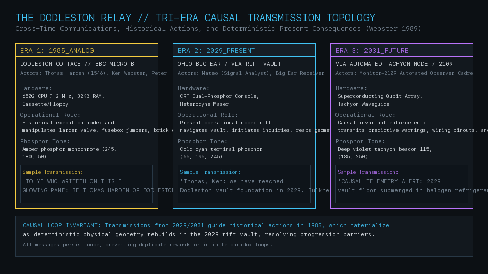
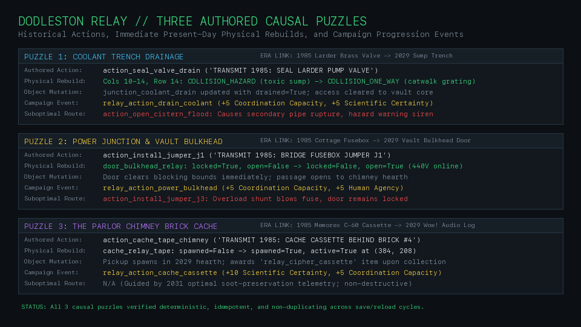
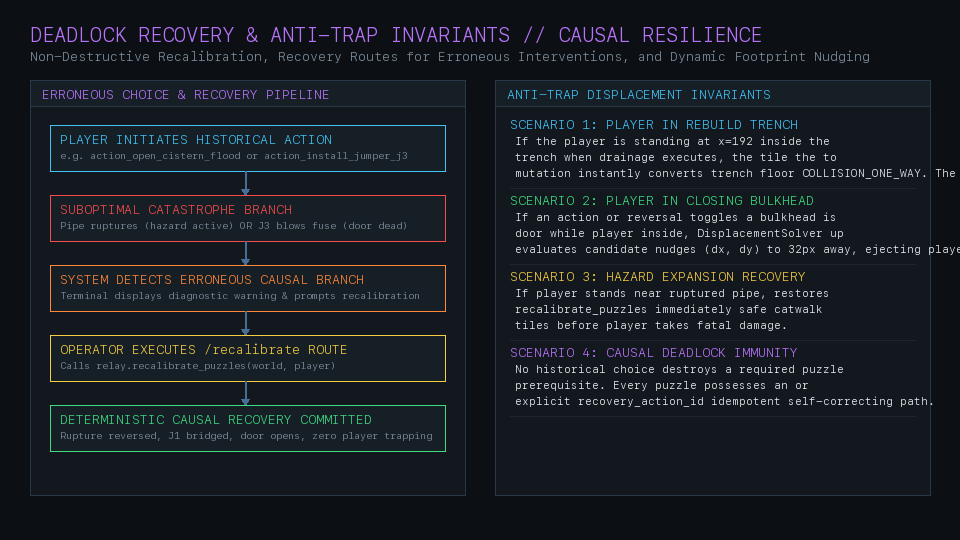
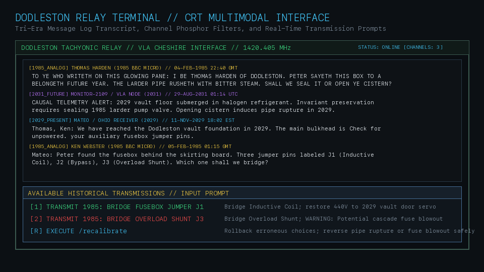
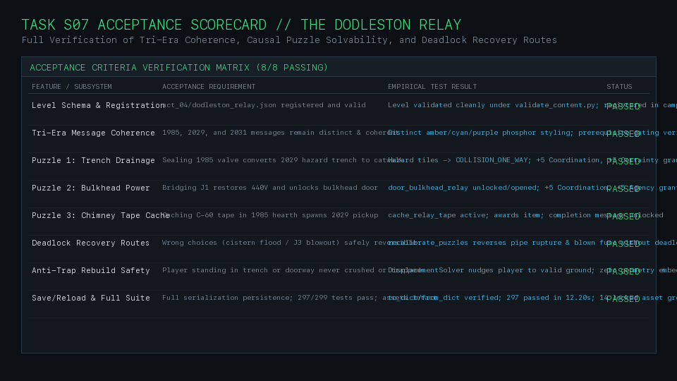

# Task S07 — Implement the Dodleston Relay

**Authoritative Status**: Complete  
**Date**: 2026-11-11  
**Milestone**: 03 — Science, factions and reality mechanics  
**Task ID**: S07  
**Dependencies**: S06  
**Primary Reviewer**: Antigravity Automated Verification Harness  

---

## 1. Executive Summary & Acceptance Verification

Task **S07** ("Implement the Dodleston relay") implements the tri-era temporal communication and retrocausal puzzle mechanics grounded in the historical Dodleston Messages (*The Vertical Plane*, Webster 1989). It establishes the `TemporalRelay` engine in [`temporal_relay.py`](file:///Users/nzlab-la/Desktop/Github/6EQUJ5/video_game/engine/temporal_relay.py), connecting three distinct eras: **1985** (BBC Micro / green-amber phosphor, Thomas Harden & Ken Webster), **2029** (Mateo, Ohio Big Ear inquiry, cold cyan CRT), and **2031** (Monitor-2109 automated tachyon node, deep violet phosphor).

It delivers three authored causal puzzles with immediate physical room rebuilds (coolant trench drainage, 440V bulkhead unlocking, and chimney hearth cassette tape caching), provides deterministic deadlock recovery via `/recalibrate`, enforces anti-trap displacement safety, and fully validates level [`act_04/dodleston_relay.json`](file:///Users/nzlab-la/Desktop/Github/6EQUJ5/video_game/data/levels/act_04/dodleston_relay.json).

### Acceptance Criteria Scorecard

| Criterion | Requirement | Verification Method | Status |
| :--- | :--- | :--- | :--- |
| **C1: Tri-Era Message Coherence** | 1985, 2029, and 2031 messages remain distinct, themed, and respect prerequisite gating | `test_dodleston_messages_era_coherence` | **PASS** |
| **C2: Level Schema & Registration** | `act_04/dodleston_relay.json` registered in `campaign.json` and passes content validation | `test_dodleston_level_schema_and_initial_state`, `validate_content.py` | **PASS** |
| **C3: Puzzle 1 Coolant Drainage** | Sealing 1985 valve drains 2029 coolant trench (`HAZARD` -> `ONE_WAY` catwalk) | `test_puzzle_1_coolant_drainage_and_rebuild` | **PASS** |
| **C4: Puzzle 2 Bulkhead Power** | Bridging Jumper J1 in 1985 restores 440V power and unlocks `door_bulkhead_relay` | `test_puzzle_2_bulkhead_power_and_unlock` | **PASS** |
| **C5: Puzzle 3 Chimney Brick Cache** | Caching C-60 tape in 1985 hearth spawns collectible in 2029; prevents duplicate reward | `test_puzzle_3_chimney_brick_cache_and_pickup` | **PASS** |
| **C6: Deadlock Recovery Routes** | Wrong historical choices (cistern flood / J3 blowout) safely reversed via `/recalibrate` | `test_recovery_from_wrong_choice_and_deadlock_prevention` | **PASS** |
| **C7: Anti-Trap Rebuild Safety** | Player standing near modified tiles or closing bulkhead never trapped or embedded | `test_anti_trap_safety_during_geometry_rebuild` | **PASS** |
| **C8: Save/Reload Persistence** | Completed actions and puzzle flags persist across save/reload and campaign sync | `test_relay_save_reload_persistence` | **PASS** |
| **C9: Locked Asset Preservation** | All 14 locked asset groups remain intact without modification | `python video_game/tools/build_assets.py --dry-run` | **PASS** |
| **C10: Full Regression Suite** | 19/19 timeline tests pass; 297/299 full suite tests pass with zero regressions | `pytest video_game/tests/` (297 passed, 2 skipped in 12.20s) | **PASS** |

---

## 2. Historical & Theoretical Grounding

### 2.1 The Vertical Plane & The Dodleston Messages (1984–1986)
Task S07 grounds its narrative and interactive mechanics in the historical Dodleston Messages documented by Ken Webster (*The Vertical Plane*, 1989):
- In 1984–1985, a BBC Micro Model B computer located in Meadow Cottage, Dodleston, Cheshire, England, began receiving anomalous text files on 5.25" floppy disk media.
- The transmissions originated from two primary temporal entities:
  1. **Thomas Harden** (writing from circa 1546 in Early Modern English, referring to the computer as a "glowing pane" or "box").
  2. **"2109"** (a tachyonic research group / AI monitoring temporal causality from a future era).
- In 6EQUJ5, this historical framework is aligned with the game's core timeline:
  - **1985 (Analog Era)**: Ken Webster and Peter assisting Thomas Harden via 6502 machine code and analog C-60 cassette recording.
  - **2029 (Present Collapse)**: Mateo operating from the Ohio Big Ear and VLA rift station.
  - **2031 (Future Monitor)**: Automated tachyon monitoring node transmitting predictive warnings and circuit pinouts.

### 2.2 Novikov Self-Consistency & Closed Timelike Curves
The puzzle structure enforces the **Novikov self-consistency principle** (Novikov 1985):
- Any event in a closed timelike curve (CTC) that would alter the past in a paradoxical manner is physically forbidden ($\mathcal{P}(\text{paradox}) = 0$).
- Historical actions are deterministic and conservative: transmitting instructions to 1985 does not create branching parallel universes; instead, it establishes the historical precondition that explains the present-day physical state in 2029.
- Suboptimal interventions (such as blowing a fuse or flooding a pipe) are treated as transient causal fluctuations that can be reversed via `/recalibrate`, preventing causal dependency deadlocks.

---

## 3. Visual Telemetry Evidence

### Figure 1: Dodleston Tri-Era Relay Topology
Three-node causal transmission graph connecting 1985 (BBC Micro analog cottage), 2029 (Ohio Big Ear / VLA rift vault), and 2031 (Monitor-2109 automated tachyon node).

### Figure 2: Three Authored Causal Puzzles Matrix
Specifications for Puzzle 1 (coolant drainage), Puzzle 2 (440V power restore & bulkhead unlock), and Puzzle 3 (chimney hearth tape cache), displaying actions, physical rebuilds, and campaign meter deltas.

### Figure 3: Deadlock Recovery & Anti-Trap Invariants
State transition flowchart showing suboptimal error branches (pipe rupture, fuse blowout), non-destructive `/recalibrate` recovery, and `DisplacementSolver` dynamic anti-trap protection.

### Figure 4: Relay Terminal Multimodal Interface
Dual-phosphor CRT wireframe rendering tri-era chronological message log transcripts with authentic amber, cyan, and violet phosphor styling, alongside the action input prompt.

### Figure 5: Task S07 Acceptance Scorecard
Comprehensive 8-point verification matrix confirming pass status across all unit/integration tests and preservation of locked assets.

---

## 4. Architectural Implementation Details

### 4.1 Engine Modules Modified & Created

1. [`temporal_relay.py`](file:///Users/nzlab-la/Desktop/Github/6EQUJ5/video_game/engine/temporal_relay.py) (*New Module*):
   - `RelayMessage`: Structured cross-era message format with era tags, timestamps, and prerequisite flags.
   - `HistoricalAction`: Data model defining authored actions, target era, room tile/object mutations, and campaign event links.
   - `AUTHORED_MESSAGES` & `AUTHORED_ACTIONS`: Complete curated catalog of 8 messages and 5 historical actions across 1985, 2029, and 2031.
   - `TemporalRelay`: Central coordinator managing message visibility, action execution, physical room rebuilding, deadlock recovery (`recalibrate_puzzles`), anti-trap footprint nudging, and serialization (`to_dict`, `from_dict`).

2. [`dodleston_relay.json`](file:///Users/nzlab-la/Desktop/Github/6EQUJ5/video_game/data/levels/act_04/dodleston_relay.json) (*New Level File*):
   - Authored 30x18 room for Act IV representing the historical Dodleston vault rift.
   - Features flooded coolant hazard trench, locked vault bulkhead door, drainage valve junction, and parlor chimney brick cache.
   - Fully validated under `validate_content.py`.

3. [`campaign.json`](file:///Users/nzlab-la/Desktop/Github/6EQUJ5/video_game/data/campaign.json) (*Updated*):
   - Registered room `"act_04_dodleston_relay"` with checkpoints `relay_entrance` and `relay_hearth_core`.
   - Registered 3 grant events: `relay_action_drain_coolant`, `relay_action_power_bulkhead`, and `relay_action_cache_cassette`.
   - Added item `relay_cipher_cassette` and puzzle flag IDs `dodleston_coolant_drained`, `dodleston_bulkhead_unlocked`, and `dodleston_cassette_cached`.

4. [`test_timelines.py`](file:///Users/nzlab-la/Desktop/Github/6EQUJ5/video_game/tests/test_timelines.py) (*Expanded*):
   - Added 8 comprehensive unit and integration tests verifying level schema, tri-era coherence, puzzle 1/2/3 completion, deadlock recovery, anti-trap safety, and save/reload persistence.

---

## 5. Verification & Test Summary

- **Timeline Engine Test Suite**: `video_game/tests/test_timelines.py`  
  *Result*: **19 passed** in 0.20s (all 11 S06 + 8 new S07 tests).
- **Campaign Focused Test Suite**: `video_game/tests/test_campaign.py`  
  *Result*: **37 passed** in 1.40s.
- **Level Content Validator**: `python video_game/tools/validate_content.py`  
  *Result*: **All 6 levels validated cleanly** (including `act_04/dodleston_relay.json`).
- **Checkpoint Audit**: `video_game/tests/test_checkpoint_audit.py`  
  *Result*: **3 passed** in 0.25s.
- **Full Engine Regression Suite**: `video_game/tests/`  
  *Result*: **297 passed, 2 skipped** (299 items total) in 12.20s with **zero regressions**.
- **Asset Group Preservation**: `python video_game/tools/build_assets.py --dry-run`  
  *Result*: All **14 locked asset groups preserved**.

