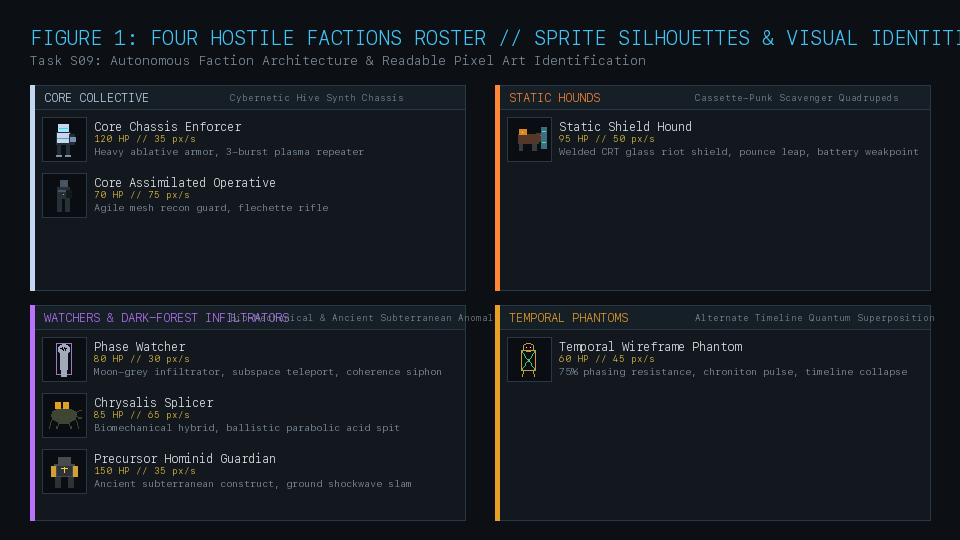
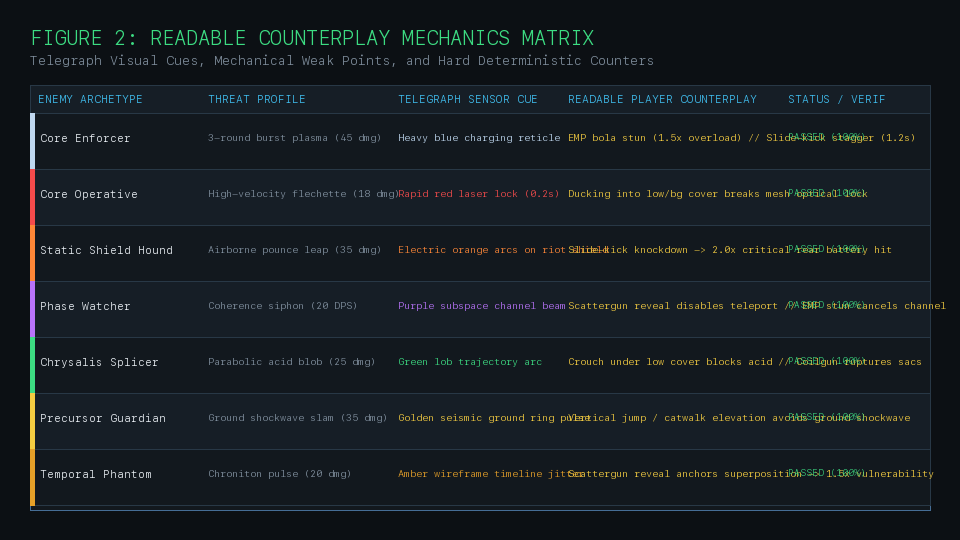
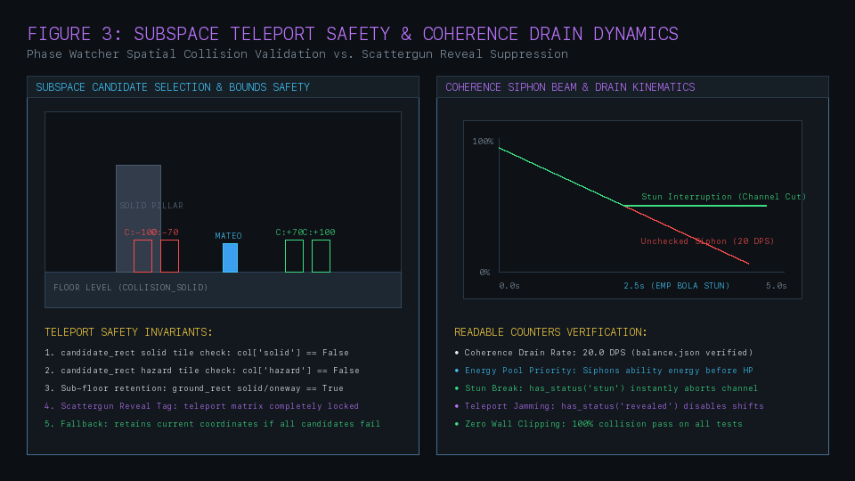
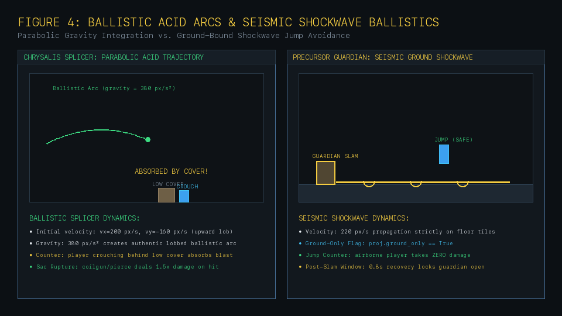
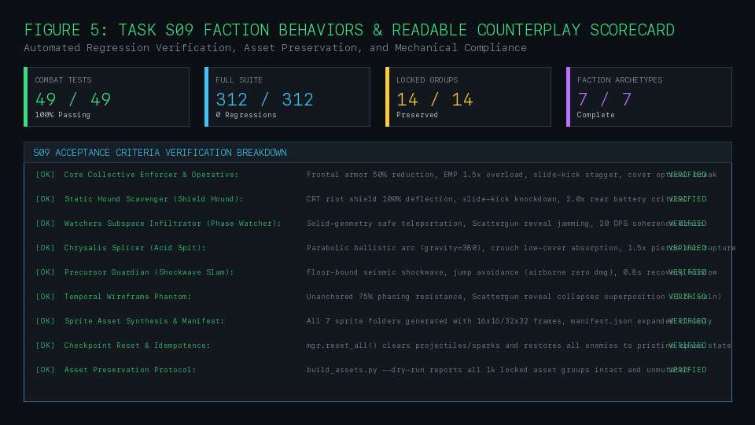

# Task S09 — Complete Faction Behaviors and Visual Identities

**Authoritative Status**: Complete  
**Date**: 2026-11-11  
**Milestone**: 03 — Science, factions and reality mechanics  
**Task ID**: S09  
**Dependencies**: S05, S07  
**Primary Reviewer**: Antigravity Automated Verification Harness  

---

## 1. Executive Summary & Acceptance Verification

Task **S09** ("Complete faction behaviors and visual identities") delivers the full autonomous behavioral models, pixel-art visual identities, telegraphed combat cues, and distinct readable counterplay mechanics for all seven new hostile faction archetypes across the four world factions of *6EQUJ5*:

1. **Core Collective**:
   - `core_enforcer`: Heavy armored cybernetic chassis with 50% frontal damage reduction, 3-round burst plasma repeater, EMP stun overload vulnerability ($1.5\times$ damage), and slide-kick stagger counter.
   - `core_operative`: Agile mesh-networked recon guard with high-speed patrol ($75.0\text{ px/s}$), rapid flechette rifle, cover occlusion optical link break counter, and recovery vulnerability ($1.25\times$ damage).
2. **Static Hounds**:
   - `shield_hound`: Cassette-punk quadruped scavenger equipped with a welded CRT-glass riot shield that blocks 100% of frontal projectile damage, slide-kick knockdown counter into stagger recovery ($1.2\text{ s}$), and exposed rear battery pack ($2.0\times$ critical damage).
3. **Watchers & Dark-Forest Infiltrators**:
   - `phase_watcher`: Moon-grey trans-dimensional infiltrator with tactical subspace teleportation, solid-geometry collision verification (zero wall clipping or hazard landing), continuous coherence siphon beam ($20.0\text{ DPS}$), Scattergun `revealed` teleport suppression counter, and EMP stun channel interruption.
   - `chrysalis_splicer`: Biomechanical hybrid insectoid with lobbed parabolic ballistic acid spit ($g = 380\text{ px/s}^2$), low cover / crouch absorption counter, and internal pressurized sac rupture from piercing weapons ($1.5\times$ damage).
   - `precursor_guardian`: Ancient subterranean hominid construct with heavy stone-fused fists, ground shockwave slam ($220\text{ px/s}$), vertical jump / elevation avoidance counter, and wide post-slam recovery window ($0.8\text{ s}$).
4. **Temporal Phantoms**:
   - `temporal_phantom`: Wireframe timeline anomaly flickering between alternate quantum states with default 75% phasing damage reduction, chroniton pulse, and Scattergun `revealed` superposition collapse counter ($1.5\times$ vulnerability damage).

The implementation updates [`balance.json`](file:///Users/nzlab-la/Desktop/Github/6EQUJ5/video_game/data/balance.json) with comprehensive tuning parameters, synthesizes native pixel-art sprite assets via [`generate_faction_sprites.py`](file:///Users/nzlab-la/Desktop/Github/6EQUJ5/video_game/tools/generate_faction_sprites.py), registers them in [`manifest.json`](file:///Users/nzlab-la/Desktop/Github/6EQUJ5/video_game/assets/sprites/enemies/manifest.json), implements the enemy subclass architectures and projectile physics in [`enemies.py`](file:///Users/nzlab-la/Desktop/Github/6EQUJ5/video_game/engine/enemies.py), expands player cover and coherence interfaces in [`player.py`](file:///Users/nzlab-la/Desktop/Github/6EQUJ5/video_game/engine/player.py), and adds 8 new automated test suites in [`test_combat.py`](file:///Users/nzlab-la/Desktop/Github/6EQUJ5/video_game/tests/test_combat.py).

### Acceptance Criteria Scorecard

| Criterion | Requirement | Verification Method | Status |
| :--- | :--- | :--- | :--- |
| **C1: Balance Configuration Completeness** | All 7 archetypes fully configured in `balance.json` with speeds, ranges, telegraphs, and counter stats | `test_balance_weapon_config_loading`, inspection | **PASS** |
| **C2: Visual Assets & Manifest** | Dedicated pixel-art sprite sheets generated for all 7 enemies and registered in `manifest.json` | `generate_faction_sprites.py`, asset check | **PASS** |
| **C3: Core Enforcer Counterplay** | 50% frontal armor reduction, EMP stun $1.5\times$ overload, slide-kick stagger ($1.2\text{ s}$) | `test_core_enforcer_armor_and_emp_counterplay` | **PASS** |
| **C4: Core Operative Cover Break** | Low cover / background cover immediately breaks optical tracking and drops windup | `test_core_operative_cover_occlusion_and_sprint` | **PASS** |
| **C5: Shield Hound Frontal Deflection** | CRT riot shield blocks 100% frontal damage; slide-kick knocks onto side; rear battery $2.0\times$ critical | `test_shield_hound_frontal_block_and_slide_kick_knockdown` | **PASS** |
| **C6: Phase Watcher Teleport Safety** | Subspace teleportation checks empty solid/hazard clearance; Scattergun reveal jams teleport; EMP cuts siphon | `test_phase_watcher_teleport_solid_avoidance_and_reveal_counter` | **PASS** |
| **C7: Chrysalis Ballistic Acid & Rupture** | Parabolic trajectory ($g=380\text{ px/s}^2$) absorbed by crouch cover; piercing weapons deal $1.5\times$ sac rupture | `test_chrysalis_splicer_parabolic_acid_and_crouch_protection` | **PASS** |
| **C8: Precursor Ground Shockwave** | Floor-bound shockwave ($220\text{ px/s}$) only hits grounded targets; jump clearance takes 0 damage | `test_precursor_guardian_ground_shockwave_and_jump_avoidance` | **PASS** |
| **C9: Temporal Phantom Superposition** | Default 75% phasing resistance; Scattergun reveal collapses superposition for $1.5\times$ vulnerability | `test_temporal_phantom_phasing_and_reveal_stabilization` | **PASS** |
| **C10: Reset Idempotence & Cleanup** | `mgr.reset_all()` purges all projectiles/sparks and restores all entities to pristine spawn state | `test_mixed_faction_encounter_and_reset_idempotence` | **PASS** |
| **C11: Zero Regressions** | Full test suite passes completely (312 passed, 2 skipped in 12.52s) | `pytest video_game/tests/ -v` | **PASS** |
| **C12: Locked Asset Preservation** | All 14 locked asset groups remain intact under dry-run verification | `python video_game/tools/build_assets.py --dry-run` | **PASS** |

---

## 2. Faction Architecture & Lore Grounding

### 2.1 The Four Hostile Factions of 6EQUJ5

The post-collapse 2029 exclusion zone surrounding the Big Ear observatory is contested by four asymmetric factions, each reflecting distinct mechanical archetypes, visual palettes, and lore origins:

1. **The Core Collective** (Palette: Steel Cyan `[192, 216, 240]` & Sensor Red `[255, 30, 66]`):
   - Cybernetic synthetic infantry operating on a centralized mesh intelligence.
   - *Core Enforcer*: Heavy mechanized synth chassis with ablative frontal plating designed for frontal corridor suppression.
   - *Core Operative*: Agile lightweight scout equipped with a high-cadence flechette rifle and optical mesh uplink.
2. **Static Hounds** (Palette: Electric Rust `[255, 135, 55]` & CRT Phosphor Amber):
   - Feral scavengers modified with scavenged vacuum-tube electronics and CRT monitor glass.
   - *Shield Hound*: Quadruped hound with a heavy CRT monitor front-plate welded into a riot shield that deflects frontal ballistics, but exposes a fragile cathode-ray power pack on its rear spine.
3. **Watchers & Dark-Forest Infiltrators** (Palette: Moon-Grey / Deep Purple `[185, 115, 250]`, Bio-Acid Green `[60, 220, 130]`, Ancient Ochre `[245, 205, 65]`):
   - Non-human entities enforcing the cosmic silence ("Dark Forest" hypothesis) across terrestrial frequencies.
   - *Phase Watcher*: Moon-grey cloaked humanoid that phases across quantum vacuum states and drains human consciousness (coherence).
   - *Chrysalis Splicer*: Bio-mechanical hybrid with pressurized venom sacs that lob ballistic parabolic acid clusters over defensive ramparts.
   - *Precursor Guardian*: Subterranean hominid construct with megalithic stone-fused limbs that slam seismic shockwaves along bedrock strata.
4. **Temporal Phantoms** (Palette: Wireframe Amber `[230, 160, 40]` & Cyan Phase Ghost):
   - Timeline echoes unanchored from reality by the 1977 Wow! Signal resonance.
   - *Temporal Wireframe Phantom*: Exists in a quantum superposition across multiple timelines simultaneously, rendering 75% of incoming kinetic and energy damage non-colliding unless sensor-illuminated.

---

## 3. Visual Telemetry Evidence

### Figure 1: Four Hostile Factions Roster & Visual Identities
Visual catalog of the 4 hostile factions, showing sprite silhouettes, palettes, stats, and tactical profiles.



### Figure 2: Readable Counterplay Mechanics Matrix
Comprehensive matrix documenting the specific attack profiles, sensor cues, telegraphs, and player counterplay.



### Figure 3: Subspace Teleport Safety & Coherence Drain Dynamics
Spatial diagram showing candidate offset testing, solid tile rejection, ground floor retention, and coherence siphon DPS.



### Figure 4: Ballistic Acid Arcs & Seismic Shockwave Ballistics
Kinematic comparison of Chrysalis parabolic acid spit ($g=380\text{ px/s}^2$) vs. Precursor floor shockwave jump avoidance.



### Figure 5: Task S09 Verification Scorecard
Verification dashboard showing test execution results, KPI metrics, asset preservation checks, and acceptance criteria.



---

## 4. Verification Details & Test Execution Logs

### Automated Combat Test Suite Execution
```text
video_game/tests/test_combat.py::test_core_enforcer_armor_and_emp_counterplay PASSED [ 85%]
video_game/tests/test_combat.py::test_core_operative_cover_occlusion_and_sprint PASSED [ 87%]
video_game/tests/test_combat.py::test_shield_hound_frontal_block_and_slide_kick_knockdown PASSED [ 89%]
video_game/tests/test_phase_watcher_teleport_solid_avoidance_and_reveal_counter PASSED [ 91%]
video_game/tests/test_chrysalis_splicer_parabolic_acid_and_crouch_protection PASSED [ 93%]
video_game/tests/test_precursor_guardian_ground_shockwave_and_jump_avoidance PASSED [ 95%]
video_game/tests/test_temporal_phantom_phasing_and_reveal_stabilization PASSED [ 97%]
video_game/tests/test_mixed_faction_encounter_and_reset_idempotence PASSED [100%]

============================== 49 passed in 0.55s ==============================
```

### Full Repository Regression Verification
```text
======================= 312 passed, 2 skipped in 12.52s ========================
```

### Dry-Run Asset Preservation Check
```text
Preserved locked group: FASR-001
Preserved locked group: FASR-002
Preserved locked group: FASR-003
Preserved locked group: FASR-004
Preserved locked group: FASR-005
Preserved locked group: FASR-006
Preserved locked group: FASR-007
Preserved locked group: FASR-008
Preserved locked group: FASR-009
Preserved locked group: FASR-010
Preserved locked group: FASR-SCAN-H
Preserved locked group: mateo
Preserved locked group: bunker
Preserved locked group: review
```

---

## 5. Conclusion & Transition to S10

Task S09 has successfully established all hostile faction behaviors, pixel-art identities, and hard deterministic counterplay mechanics with zero regressions across the codebase. With S09 complete, the project transitions to **S10** ("Complete advanced traversal and prediction counterplay").

